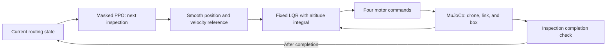

# Adaptive Drone Patrol with a Suspended Payload

A simulated drone carrying a rigid box inspects ten locations at different heights. A learned routing policy chooses **where to go next**, while a fixed flight controller handles **how to get there and settle the load**. The route can change when an inspection becomes urgent or a directed travel penalty changes.

The main result is a **single-drone, ten-location patrol in MuJoCo**. The selected routing model, F43, reduced mean logical routing cost by **2.9447%** against the previous learned model on 300 held-out routing cases. In a separate physical evaluation, **127/127 simulated missions** completed all ten inspections with the declared settling conditions. Hardware performance has not been evaluated.

The two-drone extension is **paused and incomplete**. A reduction in team patrol time has not been demonstrated.

## How it works



- **Routing:** a shared candidate-scoring neural network selects an unvisited location using observed priorities and directed travel penalties. Future events are hidden.
- **Flight:** a quintic reference trajectory avoids abrupt starts and stops. A local discrete LQR, with bounded altitude integral and anti-windup, tracks the reference at 100 Hz. The same nominal controller is used across the tested payload conditions.
- **Physics:** an inherited Crazyflie cf2x model carries a 0.30 m rigid link with nonzero mass and a rigid box, connected by two passive ball joints. Only the four original motors actuate the system.
- **Inspection:** the drone and box must simultaneously meet position, velocity, swing, and angular-speed thresholds for one continuous second before a location is marked complete.

Three demonstration scenarios share the same ten-location layout:

| Scenario | Change after the first completed inspection |
| --- | --- |
| `normal` | No change |
| `emergency` | A designated location's priority becomes 100 |
| `cost_shift` | A designated directed edge's travel multiplier becomes 5 |

The demonstration locations are approximately 2.1266–4.8680 m high; the base is at `(0, 0, 1)` m. Returning to base is not required. See [the elevated scenario files](configs/demo_scenarios_payload_elevated/).

## Routing objective and learning

For visit number $k$, traveling from location $i$ to $j$:

$$
\tau_k = \tau_{k-1} + d_{ij}/v + s_j,
\qquad c_k = \alpha d_{ij}m_{ij} + \beta p_j\tau_k,
\qquad J = \sum_{k=1}^{10} c_k.
$$

Here $d_{ij}$ is 3D distance, $m_{ij}$ is a directed travel multiplier, $p_j$ is inspection priority, and $\tau_k$ is logical completion time. The evaluated profile uses $\alpha=1$, $\beta=0.05$, $v=1$ m/s, $s_j=0.50$ s, and integer priorities from 1 to 100. Lower $J$ is better.

**Logical time and travel penalties differ from measured physical flight time.** A multiplier of 5 increases a routing penalty; it does not create wind, insert an obstacle, or multiply motor output or flight duration. The logical service time of 0.50 s also differs from the physical one-second settling requirement. A leg is scored using its departure conditions, then an event is applied at the inspection-completion boundary.

F43 uses 324 observation values and a shared actor–critic network:

| Component | Dimensions | Role |
| --- | --- | --- |
| Relation encoder | `4 → 32 → 32` | Encodes candidate-to-candidate distance, cost, priority, and service features; averages over other unvisited candidates |
| Candidate encoder | `44 → 64 → 64` | Combines relation features with local and global routing information |
| Actor | `128 → 64 → 1` | Scores each candidate using its features and pooled unvisited-candidate features |
| Critic | `64 → 64 → 1` | Estimates the scaled remaining return |

Hidden layers use Tanh. Action masking excludes visited locations during training and inference. Evaluation selects the highest-scoring eligible action, breaking ties by location index. Exact solvers and heuristics are used for teaching and comparison; they do not replace the learned policy at inference time.

Training proceeded in stages:

1. **Teacher initialization:** 12,000 training-only states, labeled with exact best next actions, for 30 supervised epochs.
2. **Initial PPO:** seeds 42, 43, and 44, each with 50,176 static transitions followed by 50,176 event-mixture transitions. The adopted seed-44 model became baseline **B**.
3. **Additional training for the elevated layout:** initialize F42, F43, and F44 from B's policy/value weights, with fresh optimizer and random-number states. Each receives 100,352 transitions; teacher initialization is not repeated.
4. **Selection and evaluation:** select F43 on 300 validation cases, then freeze the model, controller, and physical settings before the separate held-out evaluations. Held-out results do not trigger model reselection.

Mixture sampling probabilities are 50% static, 25% priority change, and 25% cost change. PPO uses optimizer reward `−0.01 × leg cost`, discount factor 1, GAE λ=0.95, clip range 0.2, rollout length 512, minibatch size 128, five epochs, learning rate 0.0003, value coefficient 0.5, and entropy coefficient 0.

Implementation: [objective.py](src/adaptive_drone_patrol/objective.py), [routing_policy.py](src/adaptive_drone_patrol/routing_policy.py), [routing_teacher.py](src/adaptive_drone_patrol/routing_teacher.py), and [elevated_routing_experiment.py](src/adaptive_drone_patrol/elevated_routing_experiment.py).

## Results

### Held-out routing: 300 cases

Each method receives the same 100 static, 100 priority-change, and 100 cost-change cases, separate from training and selection. B is the previous learned model. `Greedy` minimizes `distance × multiplier / priority`; `Fixed` visits A through J in order.

| Case type | B | F43 | Greedy | Fixed | Static exact optimum |
| --- | ---: | ---: | ---: | ---: | ---: |
| Static | 350.4447 | 340.7111 | 384.9996 | 584.6693 | 329.5922 |
| Priority change | 377.9206 | 367.5837 | 408.5573 | 634.9136 | — |
| Directed cost change | 338.2263 | 326.8891 | 363.4733 | 586.8836 | — |

All values are mean logical objective $J$. B, F43, Greedy, and Fixed each completed all 300 routing cases with zero invalid actions. Static exact solutions use subset dynamic programming. Dynamic boundary references optimize only the remaining route under the currently observed conditions; they are not full-tour oracles with knowledge of future events.

- **Overall mean:** B `355.530542` → F43 `345.061333`, a **2.9447%** reduction.
- **Paired cases:** F43 improved 170, worsened 71, and tied 59, using a cost-difference tolerance of `1e-6`.
- **Cost components:** weighted travel cost increased from `51.936831` to `56.468372`, while the weighted completion penalty decreased from `303.593711` to `288.592961`. The total improvement is not a claim of shorter distance or faster physical flight.
- **Static quality:** the mean per-case excess over the exact optimum was **3.3254%**. F43 is not always optimal.

For event adaptation, both the retained pre-event suffix and the replanned suffix were rescored from the **same post-event state**. Of 200 dynamic cases, the event could affect a remaining valid route in 175: replanning improved 37, worsened 19, and tied 119. Mean cost decreased by `6.089194`, with median change zero. In 28 of the 37 improvements, the immediate next location stayed the same and later visits changed.

Evidence: [routing-heldout.json](docs/evidence/elevated/routing-heldout.json) and [detailed measured results, Japanese](docs/elevated-payload-result-ja.md).

### Physical evaluation: 127 separate missions

The selected F43 model and fixed controller were tested with box sides of 30, 45, or 60 mm, payload mass ratios of 10–30% of drone mass, and varied initial states.

| Group | Completed / attempted |
| --- | ---: |
| Nominal box, three scenarios × three initial states | 9 / 9 |
| Mass endpoints, three sizes × two mass ratios × three scenarios | 18 / 18 |
| Held-out payload and initial-state conditions | 100 / 100 |
| **Total** | **127 / 127** |

Every inspection requires the following conditions simultaneously for one continuous second, checked every 0.01 s, together with the safety checks:

| Quantity | Threshold |
| --- | --- |
| Drone and box position errors | Each ≤0.20 m from its own target |
| Drone / box linear speed | ≤0.30 / ≤0.15 m/s |
| Link swing from downward vertical | ≤5° |
| Link direction angular speed | ≤15°/s |
| Box angular-speed norm, all three axes | ≤30°/s |

The box target is below the drone target by the attachment/link/box geometry. Each leg, including settling, has a 30 s simulated-time limit. The 600 s wall-clock gate measures from just before physical reset through flight-log flushing; model construction and later independent audits are outside that interval.

Measured mission times were **45.10–57.11 simulated seconds**, with median **49.96 s**. Minimum floor clearances were approximately **0.609 m for the box** and **0.977 m for the drone**. Transient swing reached **12.2824°**, and transient box spin reached **338.4764°/s**; the settling limits apply at inspection completion, not throughout travel.

Evidence: [physical-formal.json](docs/evidence/elevated/physical-formal.json). The 300 routing cases are not part of this physical denominator.

## Flight control and numerical checks

The controller uses 20 states: drone position/attitude, two transverse relative-rotation components at each ball joint, and their corresponding velocities. A nominal 45 mm box at 20% mass ratio is used once to design the controller. Central-difference linearization, zero-order-hold discretization at 0.01 s, and the discrete algebraic Riccati equation produce a fixed `4 × 20` gain matrix.

Motor commands combine nominal hover input, LQR feedback, and a common altitude integral limited to ±0.12, then clip to `[-1, 1]`. Anti-windup prevents an integral update that would worsen saturation. Reference limits are 1.2 m/s speed, 0.8 m/s² acceleration, and 2 m/s³ jerk, with duration at least 3 s. The nominal linear closed-loop spectral radius is `0.9961743319`; this is a local linear-model result, not a guarantee for arbitrary nonlinear motion with saturation.

The recorded physical campaign used **MuJoCo 3.15.0, float64, RK4, 16 internal substeps per 0.01 s control interval**. Validation included:

- A separately derived planar link-and-box model with a fixed attachment point, integrated by an independent RK4 implementation. At 16 substeps, maximum angle differences over 0.20 s were approximately `7.771e-11` rad for the 90° initial condition and `1.184e-9` rad for 170°; refinement reduced the differences.
- Independent reconstruction of native and RK-stage records, with zero reported same-engine replay differences for the retained formal data.
- Maximum signed work–energy residual of approximately `1.9482e-11` J and link-length residual of `2.7756e-15` m across the 127 missions.

These establish numerical agreement within the tested models and records, not agreement with a real drone. See the [controller contract](docs/suspended-payload-hybrid-controller.md), [numerical qualification evidence](docs/evidence/suspended-solver/candidate-selection.json), and [physical summary](docs/evidence/elevated/physical-formal.json).

## Quick start: CPU routing logic

Run from the repository root. Python 3.11 is recommended for the routing environment; the package declares Python ≥3.11. Use a separate environment from historical simulator installations.

```bash
python3.11 -m venv .venv-routing
source .venv-routing/bin/activate
python -m pip install -e ".[routing,dev]"
```

The following example evaluates two baselines on the checked-in elevated normal scenario. It does not require a trained checkpoint or construct a physical simulator.

```bash
python - <<'PY'
from adaptive_drone_patrol.baselines import choose_baseline
from adaptive_drone_patrol.benchmark import evaluate_scenario
from adaptive_drone_patrol.scenario import Scenario
from adaptive_drone_patrol.util import load_config

scenario = Scenario.from_dict(
    load_config("configs/demo_scenarios_payload_elevated/normal.yaml")
)
for method in ("fixed", "greedy"):
    result = evaluate_scenario(
        scenario, lambda state: choose_baseline(state, method)
    )
    print(method, result["order"], f'J={result["analytical_cost"]:.6f}')
PY
```

Run focused routing and cost-verification tests:

```bash
python -m pytest tests/test_routing.py tests/test_analytical.py -q
```

This checks software behavior, not the physical results above. Historical frozen single-drone source-v6 regression recorded **1,226 passed, 20 skipped, and one GPU-only test excluded**; that is a saved campaign result, not a claim about a fresh checkout's test run. Dependency snapshots are under [requirements/](requirements/), and installable extras are defined in [pyproject.toml](pyproject.toml).

## Models, videos, and reproduction

Large checkpoints, raw traces, PDFs, videos, and archives are stored outside Git. **A clone alone does not contain the F43 checkpoint or reproduce the full physical campaign.** Local artifact paths below are relative to the repository root; they are not public download links.

| Local artifact | Path |
| --- | --- |
| Accepted single-drone run, models, and full evidence | `outputs/suspended_mujoco_elevated_20261025T141122Z/` |
| Original three F43 videos | `final-{normal,emergency,cost_shift}-media-v1/hud.mp4` within that run |
| Edited video with revised Japanese captions | `outputs/final_submission_video_revision_20261101_v2/submission.mp4` |
| Generated technical PDF and reproduction package | `outputs/final_submission_20261029T165500Z/` |

The edited video is approximately **178.27 s**, including explanatory cards and completion stills, with all flight at 1× simulation time. Production records and input bindings are documented in [docs/final-submission-production-ja.md](docs/final-submission-production-ja.md). The concise Japanese report used for this README is a separately provided document; the generated PDF at the local path above is the earlier, longer report.

The prepared reproduction package contains frozen single-drone source-v6, F43 and its observation schema, the saved LQR design, scenarios, assets, and nine saved decision observations. It differs from the later two-drone code in the current source tree. F43's checkpoint SHA-256 is:

```text
ee966a2f761b513074c6df2e7de177b3d7bc76ac9d5ec3602d273e5210e84652
```

If the package has been supplied, copy its `reproduction/` directory to a new location, enter it, and use a separate Python 3.11 environment:

```bash
python -m pip install -r dependencies/smoke-requirements.txt
PYTHONPATH=source/src python smoke.py
```

The recorded lightweight check matched **9/9 saved F43 decisions** and verified imports and entrypoint loading, with zero physical steps. Its Intel macOS environment used MuJoCo **3.3.7**, so it does not establish compatibility with the campaign's **3.15.0** physics. Full physical reproduction additionally requires the recorded engine environment, original qualification evidence, and verified input bindings. Original video inputs are also needed for video rebuilding. A self-contained public download of all these inputs is not established here; see the [single-drone handoff](docs/elevated-payload-handoff-ja.md).

## Limitations and two-drone work

- **Model scope:** the rigid link can transmit compression and cannot model cable slack, stretch, or bending. The box has rotational inertia, but real aerodynamic, sensing, and actuation uncertainty has not been validated. Controller state measurements are ideal and delay-free.
- **Routing scope:** F43 worsened 71/300 cases, and event replanning worsened 19/175 applicable cases. Neither global optimality nor improvement on every event is claimed.
- **Two-drone scope:** seed 42 stopped after **107/256 planned updates**; seeds 43 and 44 did not start. Validation, model selection, joint freeze, and final learned-coordination evaluation were not reached. Development was paused because of elapsed time and uncertainty about reaching the objective. Training diagnostics showed frequent leg timeouts and reference-generation failures; decreasing training loss did not establish success.

Future two-drone work would first address feasible reference transitions, reassignment, waiting, and mission completion. Collision-avoidance proposals include full drone/link/box safety envelopes, space–time scheduling, and predictive slowing, waiting, or rerouting. Their effectiveness for this task remains unverified. Details and retained diagnostics are in the [two-drone pause report](docs/dual-coordination-pause-ja.md).

## Project map and references

| Location | Contents |
| --- | --- |
| [src/adaptive_drone_patrol/](src/adaptive_drone_patrol/) | Routing, flight control, simulator adapters, evidence checks, and later two-drone work |
| [configs/](configs/) | Training profiles, scenarios, and camera configuration |
| [scripts/](scripts/) | Experiment, inspection, packaging, and document/video tools |
| [tests/](tests/) | Software contracts, numerical checks, and artifact verification |
| [docs/evidence/](docs/evidence/) | Compact saved evidence; large raw data remain outside Git |
| [specs/README.md](specs/README.md) | Specifications and development history |

This project integrates established routing learning and feedback control; it does not propose a new PPO or LQR algorithm. Relevant research includes [PPO](https://arxiv.org/abs/1707.06347v2), [GAE](https://arxiv.org/abs/1506.02438v6), [invalid action masking](https://arxiv.org/abs/2006.14171v3), [geometric control of cable-suspended loads](https://hybrid-robotics.berkeley.edu/publications/CDC2013.pdf), [learned motor control](https://arxiv.org/abs/1707.05110v1), and [learned routing](https://arxiv.org/abs/1803.08475v3). Proposed collision-planning directions refer to [PolyFly](https://arxiv.org/abs/2510.15226v2), [quadrotor swarm trajectory planning](https://whoenig.github.io/publications/2018_T-RO_Hoenig.pdf), and [distributed MPC trajectory generation](https://arxiv.org/abs/1909.05150v2).

Earlier unsuccessful motor-policy learning and simulator investigations are preserved in the [solver-recovery handoff](docs/suspended-payload-solver-recovery-handoff.md). They are distinct from the successful fixed-controller F43 patrol described here. The original prototype remains in [adaptive_drone_patrol_20261013/](adaptive_drone_patrol_20261013/).

Project code is licensed under [Apache License 2.0](LICENSE). Upstream code, simulator and cf2x assets, libraries, and fonts retain their own notices; see [THIRD_PARTY_NOTICES.md](THIRD_PARTY_NOTICES.md).
