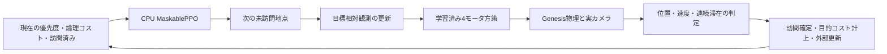

# 適応型ドローン巡回点検

A・B・Cの3地点を、学習済みのルーティング方策と飛行方策で巡回する課題です。優先度または論理移動コストの変化を、実際の到達・滞在完了後に受け取り、次の未訪問地点を再選択します。Genesisの実物理を使い、巡回・カメラ映像・テレメトリ・イベントを同じ実行で記録します。

上位はCPUのMaskablePPO、下位はGenesis/RSL-RLのPPOです。2つの方策を別々に学習しています。障害物認識、バッテリー推定、センサによる設備点検、実機安全性は対象に含みません。

## 実行結果

ルーティングはシード42/43/44で、それぞれ静的50,176ステップ＋イベント混合50,176ステップを学習しました。最終モデルは検証用100例で選択したシード43です。テスト結果を使ってモデルを選び直していません。学習時の混合比は静的50%、優先度更新25%、コスト更新25%で、イベント値は最初の点検完了境界で観測済み状態からサンプルします。

同じ静的100例／動的50例を各モデルで評価しました。3シード平均の目的コストは静的28.717 ± 0.247、動的31.357 ± 0.215です。これはシードごとの平均の標準偏差で、300例／150例の独立標本として扱っていません。全評価で完了率100%、無効アクション0でした。

固定A-B-Cに対する平均差は静的 -6.118、動的 -4.054でした。貪欲法に対する差は静的 +0.165、動的 +0.038で、常に優れているわけではありません。静的のRL／厳密最適コスト比は平均約1.041です。これらはモデル単位であり、電力や実飛行時間ではありません。詳細は `outputs/evaluation/{static,dynamic}/` と [検証記録](docs/verification.md) にあります。

GPUでは32環境・2反復の実行スモークを経て、提供ノートブックと同じ256環境・301反復で飛行方策を学習しました。保存・再読込、4秒の実録画、外部1目標、連続2目標、3シードの連続3目標、実GPU契約テストを検証しました。通常・緊急度更新・コスト更新は各3回、9件すべてで3地点を完了しました。通常はA→C→B、両更新はA→B→Cとなり、同一到達境界の更新なし推論Cから実際の選択Bへ変わりました。最終レビューの終了処理修正後にも、同じ固定モデル対でGPU契約テストと9件を再検証し、すべて成功しました。GPU累計は1,233.70秒（約20分34秒）です。

成果物：`outputs/videos/submission.mp4`（120秒）、`outputs/report/report.pdf`（日本語3ページ）、`artifacts/manifest.json`（全保持ファイルのSHA-256とサイズ）。

## 構成と判定



到達基準は半径0.20 m以内、速度0.30 m/s以下を連続0.20秒維持し、合計0.50秒滞在することです。途中で条件を外れれば保持時間を戻します。落下、リセット、非有限値、目標不一致、タイムアウト、プランナー通信エラーを訪問成功にしません。目標を変えても機体位置・前回のモータ操作をリセットしません。物理巡回は`return_to_base=false`に限定し、返航の指定は実行前に拒否します。任意返航の名目コスト計算はCPU環境でテストしています。

計画のコストは、距離×有向辺倍率と、優先度×名目完了時刻の和です。辺倍率は抽象的な経路ペナルティで、物理速度や障害物を変えません。初期位置S=(0,0,1)、A=(0.6,0,1)、B=(-0.3,0.519615,1)、C=(-0.3,-0.519615,1) m。地点間隔は約1.039 mです。3シナリオは同じ初期状態・モデル・座標・判定条件で実行します。

## ローカルCPU環境

今回のIntel MacではPython 3.11を使いました。Python 3.13と新しいSB3では対応するIntel向けTorch wheelがないため、互換性を確認したSB3 2.4.1／Contrib 2.4.0／Torch 2.2.2を分離して使用しています。ロックはこのプラットフォーム専用です。

```bash
python3.11 -m venv .venv-routing311
source .venv-routing311/bin/activate
python -m pip install -r requirements/routing-local.lock.txt
python -m pip install -e '.[routing,dev,report,video]' --no-deps
export MPLCONFIGDIR=/tmp/patrol_mpl
python -m pytest -m 'not gpu' -q
python -m ruff check src scripts tests
```

CPU側はGenesisをインポートせず使用できます。学習・評価の実行例です。出力先がすでに存在する場合は、新しい名前を選んでください。

```bash
python scripts/train_routing.py --config configs/routing_train.yaml --seeds 42 43 44 --out outputs/routing_new
python scripts/eval_routing.py --models outputs/routing_new/models.json --split static --episodes 100 --out outputs/evaluation/static_new
python scripts/eval_routing.py --models outputs/routing_new/models.json --split dynamic --episodes 50 --out outputs/evaluation/dynamic_new
python scripts/select_demo_scenarios.py --models outputs/routing_new/models.json --out outputs/demo_selection_new
python scripts/save_scenario_manifests.py --out outputs/scenario_manifests_new
```

実際に採用したモデルは `outputs/routing_boundary/models.json`、選択の根拠は検証結果です。`outputs/routing/` はイベントサンプル方式修正前の初回モデルで、最終評価には使っていません。生成済みの共通シナリオと3万件の学習候補カタログを保存しています。将来イベントの対象・時刻・値は方策観測に入りません。観測は65要素の固定スキーマで、モデル横の `.schema.json` にオフセットと正規化定数があります。

## GPUサーバの実行

接続先や秘密鍵はリポジトリに含めません。承認済みSSH方法と作業ディレクトリを使ってください。既存環境をまず読み取り確認し、飛行環境を保存します。Linux CUDAロックをMacにインストールしてはいけません。

今回の新規サーバには元の学習済みモデルがなかったため、公式v1.4.3ソースから再学習しました。元の `/venv/main` は変更せず、作業ディレクトリの `.venv-flight` にGenesis 1.4.3を準備しています。[ベースライン](docs/proven-baseline.md)と[互換性](docs/compatibility.md)に、新規実行とノートブック保存結果を区別して記録しました。

```bash
# まず承認済みリモート作業ディレクトリで実行。
export PYTHONPATH="$PWD/src"
python scripts/transfer.py --out /tmp/patrol_source_new.tar.gz
# 接続設定は外部のSSH aliasを使用してscpし、新規作業ディレクトリに展開。

# 自分の管理する学習ログから、番号の最大のチェックポイントを明示的に固定。
.venv-flight/bin/python scripts/doctor.py --config configs/execution_new.yaml \
  --freeze-log-dir baseline/logs/UNIQUE_EXPERIMENT --source baseline/hover_env.py
```

`configs/execution.example.yaml` を参照し、ignoredの `configs/execution.yaml` に確認済みパス・ハッシュ、CPUプランナーのPython、採用シナリオ、判定設定を指定します。プランナーはLinux CPU環境に分離し、JSONで1つの常駐プロセスに問い合わせます。欠損・ハッシュ違い・応答エラーは失敗になります。

```bash
tmux new-session -d -s patrol_unique \
  'bash scripts/run_remote_job.sh --out outputs/jobs/unique \
   --ledger outputs/gpu_ledger.json --timeout 3600 -- \
   .venv-flight/bin/python scripts/run_demo_scenarios.py \
   --config configs/execution.yaml --mode genesis --record --trials 3 --out outputs/genesis_new'
```

GPUジョブは同時に1つだけ、累計8時間までです。台帳は再開時も維持します。`outputs/jobs/*/status.json` の実終了状態と終了コード、必要な成果物を確認してください。tmuxが存在するだけでは成功を意味しません。元の学習スクリプトは同名ログを削除するため、必ず新規の実験名を使います。

追加の検証コマンドです。今回は `PATROL_EXECUTION_CONFIG=configs/execution_trained.yaml` でGPUテストを実行しました。

```bash
.venv-flight/bin/python scripts/reproduce_baseline.py --config configs/execution.yaml --out outputs/baseline/replay_new
.venv-flight/bin/python scripts/train_flight.py --config configs/flight_train.yaml --execution configs/execution.yaml --num-envs 32 --iterations 2 --out outputs/flight/smoke_new
.venv-flight/bin/python scripts/eval_flight.py --config configs/flight_eval.yaml --execution configs/execution.yaml --mode sequential-targets --out outputs/evaluation/flight_new
PATROL_EXECUTION_CONFIG=configs/execution.yaml .venv-flight/bin/python -m pytest -m gpu -q
```

## 成果物の再生成・ローカル保存

Gitにはソース・設定・ロック・文書・コンパクトな結果だけを保存し、生動画、モデル、ノートブックの埋込みメディアはローカルのignored出力に残します。SSHで戻すのは許可したファイルだけにし、リモート `.git`、仮想環境、秘密設定、キャッシュを同期しません。削除付き同期は使いません。

```bash
python scripts/replay_decisions.py --run outputs/genesis/normal_seed_1 --out outputs/previews/normal_new
python scripts/plot_results.py --out outputs/evaluation/figures_new
python scripts/build_video.py --config configs/video.yaml --input-root outputs/genesis --out outputs/videos/submission_new.mp4
python scripts/build_report.py --source docs/report_ja.md --out outputs/report/report_new.pdf
# ffprobeがあるLinux側で、全動画デコードと時刻対応を検証。
python scripts/check_media.py --run-root outputs/genesis --submission outputs/videos/submission.mp4 --timeline outputs/videos/timeline.json --out outputs/evaluation/media_checks_new.json
python scripts/create_manifest.py --out artifacts/manifest.json
python scripts/verify_delivery.py --manifest artifacts/manifest.json --require-local-artifacts
python -m pytest -m 'not gpu' -q
python -m ruff check src scripts tests
git diff --check
```

再生成時の動画`submission_new.mp4`には`submission_new.timeline.json`と`submission_new.selection.json`が付きます。既存の出力セットやマニフェストは上書きせず、別名を指定します。ソース転送では`execution.example.yaml`以外の`execution*.yaml`をすべて除外します。

動画は実際のカメラフレームを主画面にし、同一実行のログを重ねます。低速再生や編集は表示します。物理時間・距離とモデル目的コストは分けて示します。プランナーの反実仮想は別の物理飛行ではありません。提出・公開・pushは行っていません。

詳しいライセンスと独自性は [THIRD_PARTY_NOTICES.md](THIRD_PARTY_NOTICES.md) を参照してください。
