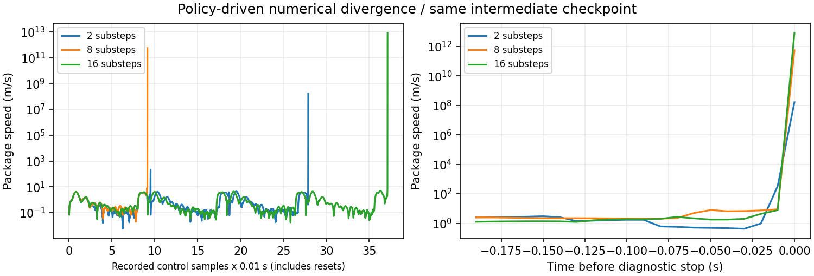

# 吊り荷飛行の実装・実現性検証 引き継ぎ

2026-10-21。**実装は部分完了、物理実現性ゲートは不合格、受入は未達**。この状態のモデルを採用・運用しない。GPU学習を停止し、CPU検査・証拠回収・文書更新を行った。固定リンク方式全般が不可能だという結論ではなく、今回の関節表現が運用域で数値安定性を満たさなかったという結果である。

## 起点・保護・仕様

[対象spec](../specs/2026-10-17-suspended-payload-flight/spec.md) の2026-10-21更新版を入力とした。[実装計画](superpowers/plans/2026-10-21-suspended-payload-flight.md) を作成し、同日のユーザーの明示指示により、追加の計画承認を待たず実装した。spec中の未承認・未開始という文章は作成当時の状態記録として保持する。

HEADは指定どおり `f3e33747ebd62d5e5e0466cb671a1b39069d182f`、分散配置の実装は `1e4e53e5fd6c59dd913a2e2d57094deb4b8a97bd`。reset/amendは行わず、開始時のstageはspec indexだけだった。入力spec原本は `outputs/suspended_20261021_v1/spec-input-20261021.md`、SHA-256 `f0e5efa9679470786b7e82db8ff69c49075727724d605e33b7efa524ed88addf`。個人ファイル、.DS_Store、歴史コピーは対象から除外した。先行のマージ済みspecと成果物は歴史記録として保持する。

配置seed51000/candidate3353、S=(0,0,1)、`configs/demo_scenarios_dispersed/` の全精度座標を維持した。高さを持ち上げず、地点を再抽選していない。重要度seed40029、A81/B42/C43/D64/E23/F84/G6/H98/I22/J56、整数1〜100、除数100、alpha=1、beta=.05、有向倍率1〜5を継承する。新しい実完了境界が存在しないため、緊急C43→100、F→Aのみ1→5の**吊り荷イベント時刻は未測定**。過去の4.72秒を流用しない。

## 入力モデル・実設定

実ファイルをspec・handoff・manifestと照合した結果は [inputs.json](evidence/suspended/inputs.json)。配列shapeだけで互換と判断せず、実cfgの初期位置、範囲、scale、clip、安全条件、actor/criticを検査した。

|用途|リポジトリ相対パス|bytes|SHA-256|
|---|---|---:|---|
|現在の無荷物飛行初期値|`outputs/dispersed_20261020_v1/remote-final/outputs/dispersed/finetune_v2/model_4296.pt`|475573|`26658a31560f71c36fd9e9605b15d8e4f7b9cae8174c1465fd12dcd0d10b3431`|
|対応cfg|同ディレクトリ `cfgs.pkl`|1628|`35c6b0be8db90e4e799d453d447a484275317f85098a22cbdf04c19c84056e55`|
|整数routing|`outputs/integer_20261020_v1/training/seed_44.zip`|297837|`a28ac49e696c7439b69ce90979be5a919df489e00a12f077c100cb735b1debef`|

**採用済みの吊り荷方策・設定はない**。途中の `model_2000.pt` は数値破綻を再現する診断用であり、採用モデルではない。`model_1300.pt`、失敗した分散配置モデル、fractional routingへ戻していない。

## 物理近似とpinned実装の調査

Genesis 1.4.3の実装を読み、DroneはURDFのローターlinkへ局所z推力と回転方向に応じた反トルクを適用し、articulationを通してrootへ伝達することを確認した。平面を先に作る今回のsceneではrotor indexは2/3/4/5、spinは−/＋/−/＋。単一ローターの短時間励起でroot角速度のroll/pitch/yaw符号は順に (−,−,−)、(−,＋,＋)、(＋,＋,−)、(＋,−,＋) と実測一致した。rootは元の `base_link` の原点で、articulation全体の重心ではない。

元のURDF機体質量は0.027 kgだが、実solverでは質量0の4ローターにfloat32 epsilonが入り、元の5 link合計は **0.02700047753751278 kg** だった。荷物質量の基準をこの実測値へ修正してprobeを再実行した。荷物はその10〜30%、箱の一辺は0.030/0.045/0.060 m、各軸慣性はm×一辺²/6である。慣性と質量を別々に更新し、collision AABBも実測した。

`payload_asset.py` は機体下方0.020 mの取り付け点から0.30 mの剛体棒、上側2軸・下側3軸の受動continuous joint、実質量・慣性・衝突cubeを持つURDFを生成する。棒質量0.0001 kg、3個の補助gimbal各0.000001 kg、補助慣性1e-10 kg m²。追加joint dampingとarmatureは0。Genesis Drone既定のbase角速度減衰を継承した。荷物への位置強制補正、姿勢追従、人工的な揺れ打消しは行わない。cubeの最下点は姿勢を反映した `z_center − side/2 × Σ|R_zj|` で判定する。

これは**圧縮力も伝え得る固定リンク近似**であり、張力のみのロープの検証ではない。pinned公開APIに内部で消去された関節反力wrenchの直接getterは見つからず、質量依存のroot運動、拘束残差、ローター励起、受動系のエネルギーを観測した。内部張力の符号を測ったとは主張しない。

3寸法はそれぞれ独立sceneとして構築し、選択sceneのみstepする。非選択sceneのsolver/接触が選択機へ力を伝えることはない。episode resetのたびに寸法を等確率、質量を独立一様抽選し、選択sceneのmass/inertiaと初期状態を設定する。30回resetで寸法・質量・慣性・初期姿勢・非選択sceneの不変を検査した。初期化だけの固定抽選ではない。全10目標の途中ではresample/resetしない設計である。

## 観測・学習・実装範囲

新contractは `payload29-ideal-world-v1`。旧17観測へ荷物相対位置3、相対速度3、実取り付け点間の方向3、方向角速度3を追加する。世界座標、quaternion wxyz、追加scaleは1/.30、1/3、1、1/pi、clipは±1。正確な質量・寸法・慣性・geometry ID・seedはactorに渡さない。理想sim状態を使い、画像認識・センサ推定は対象外。

旧actor/criticの最初の128×17行列を128×29へ拡張し、旧17列をコピー、追加12列を0初期化する。他のtensorはコピーし、optimizerとiterationをリセットする。学習と比較は同じ初期tensor・seed7・1 active environment・3000更新×100 step=300000環境stepを予定した。学習率3e-5固定、PPO、同じreward/optimizer/architecture/curriculumをmanifestで一致検査する。既存HoverEnvの実装では、cfgのlatency flagと異なり入力actionが即時適用され、学習観測はlast_actions更新前、target adapterの再観測は更新後となる。この実動作を調べて継承し、flagの名称から遅延実装があると推定しなかった。

curriculumはhover、短距離、中距離、長距離、反転・上下、分散XYZの6段階。各stageで荷物分布全体を使用する。training stream710、validation720、held-outの宣言caseを分離。最終同予算checkpointをvalidation前に候補として固定し、validation全12ケース×10遷移を独立再構成してからheld-outを開く設計である。今回はそこまで到達していない。

`payload_runtime.py`、`evaluate_payload_flight.py`、`check_payload_trials.py` は同時1秒settling、target切替時の状態・履歴維持、実判断境界イベント、actual actor/batch/hash照合、routing判断の再計算を実装した。ただし**この物理系でend-to-endの有効性を実証していない**。CPU fixtureは物理成功の証拠ではない。観測のclip前後と飽和時間はsampleから記録・検査する設計であり、採用方策の全域測定値はない。現行の無荷物routing・flight source・シナリオは変更していない。先行品質の回帰はCPU全226試験（GPU1件除外、39警告）で検査したが、先行GPU gateの新規再実行とは扱わない。

## probe結果・失敗・停止判断

[feasibility.json](evidence/suspended/feasibility.json)、[独立raw検査](evidence/suspended/failure-check.json)、[短時間物理audit](evidence/suspended/physical-audit.json) を参照する。

短時間v4の13 probeでは固定anchor 10秒の全3寸法×3質量、半dt比較、0.60秒のcoupled重量補償、4単独ローターを測定した。小角固有周期は約1.12〜1.15秒で線形化計算との差0.062%以下、energy drift約1.6%以下、半dtで約0.75%以下。半dt比較の位置差は約0.232 mm以下、角度差約0.0445度以下。coupled最低cube床余裕は約0.6136 mだった。[静的地面余裕](evidence/suspended/geometric-clearance.json) は全127初期条件で最下点0.6200249 m以上、開始点と全目標の直立静止では0.620 m以上だった。箱上面から中心までの半辺を含む任意姿勢の保守下界は0.5980385 mで、動的遷移の保証ではない。この範囲の検査に通った `preflight-v4.json` は、**長時間安定性を保証しない**。このprobeだけで学習を開始した点は検証範囲が不足していた。

ランダム化学習の初回はRSLのenv.cfg不足で開始失敗。修正後の実行では約215500環境stepまで進んだが、rewardが−3e9から−9.47e26程度へ破綻したため中断した。完了checkpoint/final.ptはない。旧学習版は異常rewardを即abortせず、初期失敗の完全なstep traceも残していなかった。保存checkpointを同じseed・同じ荷物分布で再実行し、診断時には破綻までのraw stateを全step記録した。

|substeps|physics dt|保存sample|結果|
|---:|---:|---:|---|
|2|0.005秒|2789|機体速度約8.3×10⁶ m/s、荷物速度約1.64×10⁸ m/sへ破綻|
|8|0.00125秒|914|荷物速度約5.44×10¹¹ m/sへ破綻|
|16|0.000625秒|3714|荷物速度約8.16×10¹² m/sへ破綻|

全て同じ途中checkpoint、入力actionは±1以内。dt細分化でも解消しない。補助Euler関節の小慣性・表現の特異性などが候補だが、厳密な根本原因の切り分けは未完了。質量・荷物範囲・依存版・方式・判定閾値を勝手に変えて合格にしていない。診断ジョブのprocess statusがSUCCEEDEDなのは失敗記録の保存に成功した意味で、物理summaryは3件ともFAILEDである。



現在の `configs/payload_preflight.yaml` は `operating_domain_admission: blocked_numerical_instability`。旧PASSのhash・短時間の結果だけでは訓練・モデル凍結を再開できない。将来用CPU修正として、学習のtarget-relative6/4/3 m envelope、reset前terminal記録、数値excursion即停止を追加した。**この修正版はGPU再実行しておらず、数値破綻の修理とは主張しない**。受入閾値・timeoutは変更していない。

具体的な次案はpinned 1.4.3で受動球関節を直接表せるarticulation（MJCF等）を調べ、機体root/rotor適用先・慣性・接触を再auditすること。その上で長時間のモーター入力、全質量・寸法、初期擾乱、反転・上昇・下降・同時変更を**学習前**probeへ追加する。今回その代替方式は実装していない。物理表現を変える前にspecへの適合を確認し、分布・閾値・timeoutの変更が必要ならユーザーの明示確認を得る。

## 固定評価・比較・動画・人手確認

事前宣言caseは `outputs/suspended_20261021_v1/cases-v1.json`、SHA-256 `f98e0632d96a4d7b40feda667bff6e9ca831fc7f67e1734f2438e3c527ecf01c`。基本9・端点18・held-out100を同じ127条件で両方策へpaired適用する設計で、100件は各scenario×sizeに11件ずつとsmall/normalへ1件を追加する。初期擾乱もcaseに固定した。このmanifestのstatusはNOT_RUN、attachment寸法は運用profile受入前のPROVISIONALで、受入凍結済みとは呼ばない。

|項目|ランダム化|固定荷物比較|
|---|---|---|
|学習|途中停止|未実行|
|validation|未実行|未実行|
|基本9|0件実行 / gate未判定|0件実行|
|端点18|0件実行 / gate未判定|0件実行|
|held-out100|0件実行 / gate未判定|0件実行|

**254試行中、受入実行0件**。成功率・信頼区間・優劣は推定できない。失敗診断を受入試行へ数えず、分母やseedを削減していない。新しい実判断からのQ*/J*/suffix説明も未達。固定比較に対するランダム化の優位性を主張しない。

完全raw・日本語HUD付き通常/緊急/コスト変化の3本は生成していない。基本seed1という選定規則は保持するが、採用方策、loaded camera、受入用freeze、最終動画hash、全decode/画素/字幕checker、人手視聴はいずれも未達。最終3本がないため今回の人手確認は未依頼。過去の無荷物動画承認を転用しない。統合demo_fullと提出用再編集は対象外。

## GPU・環境・外部成果物

flightとCPU routingは新しい隔離venv、Python3.12でLinux lock全169版/33版に一致。[environment.json](evidence/suspended/environment.json)。初回Python3.11のav要件不適合とuv index選択失敗も保存した。依存版の変更はない。

開始5779.474017477245秒、今回1704.619154837914秒、**累計7484.093172315159秒（約2.079時間）、残り21315.90682768484秒（約5.921時間）**。全39 jobのうち今回11 jobを加算し、初期化、失敗、学習、診断を含む。GPUは常に1 job、有限timeout、現在activeなし。両台帳一致。[GPU集計](evidence/suspended/gpu-summary.json)、[共通台帳](evidence/gpu_ledger.json)。事前配分はfeasibility1800、両学習各4200、validation1800、評価7000、撮影2500、検証1000、予備520.525983秒。物理失敗による停止であり、予算不足による評価削減ではない。

全成果物はGit管理外の一意な `outputs/suspended_20261021_v1/`。外部delivery archiveは14234257 bytes、SHA-256 `f859f5c87761e34cdc29750d5da32664c9e67042fc3339e2197b837cffc5a330`。展開先 `remote-final/` のmanifest全278ファイルについてサイズ/SHA-256を再照合した。[転送receipt](evidence/suspended/transfer.json)。実行済みremote sourceと最終CPU修正版は異なる。特に学習時sourceは `source-before-substeps.tar.gz`（28074 bytes、SHA-256 `8de9045eb9fe4301ff87ba9d38f9fabc3a6e766ae5376687211dec81fc2c28b8`）へ保存し、manifestのtraining/bank source hashと一致する。失敗モデル、実設定、raw telemetry、ソースをこの束で追跡する。大容量log・モデル・秘密情報はGitへ含めない。

## CPU再実行と次の入口

GPU再開は物理方式の修理と新しい事前検証が前提。現状の旧PASSを使って学習してはならない。以下はGPUを使わない検査である。既存ファイルの上書きを防ぐので新しい出力名を使う。

```bash
export PYTHONPATH=src
.venv-routing311/bin/python -m pytest -m 'not gpu' -q
.venv-routing311/bin/python -m ruff check src scripts tests
.venv-routing311/bin/python -m compileall -q src scripts tests
.venv-routing311/bin/python scripts/check_payload_failure.py \
  --delivery outputs/suspended_20261021_v1/remote-final \
  --out outputs/suspended_20261021_v1/failure-recheck-new.json
.venv-routing311/bin/python scripts/verify_payload_probes.py \
  --root outputs/suspended_20261021_v1/remote-final/outputs/probes_v4 \
  --out outputs/suspended_20261021_v1/passive-recheck-new.json
.venv-routing311/bin/python scripts/prepare_payload_cases.py \
  --out outputs/suspended_20261021_v1/cases-recheck-new.json
```

`check_payload_failure.py` のCONFIRMED_NUMERICAL_FAILURE、`verify_payload_probes.py` のDIAGNOSTICS_ONLYを期待する。後者を学習許可へ読み替えない。物理修理後に再検証する場合は、新規workspaceへ実設定を生成し、lock別venv、既存累計GPU ledger、job supervisor、有限timeoutを継続する。歴史的probe起動列はdelivery内 `probes-v4.sh`、学習/診断実コマンドは共通台帳に保存した。履歴commandの作業パスを新規環境へそのまま流用しない。

将来の訓練入口は `train_payload_flight.py`、validation/acceptanceは `evaluate_payload_flight.py`、モデル凍結は `prepare_payload_models.py`、独立受入は `check_payload_trials.py`。いずれも未完成モデルやstale bindingを拒否するが、この実装の成功を保証するものではない。CPU検査・PDFの最終receiptは [verification.json](evidence/suspended/verification.json)、[report.json](evidence/suspended/report.json)、総合未達は [acceptance.json](evidence/suspended/acceptance.json) を参照。push、PR作成・マージ、動画公開、コース提出は行っていない。
