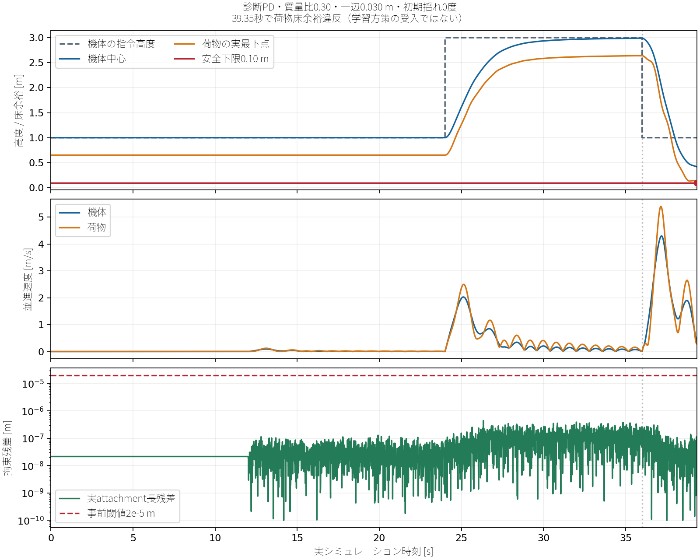

# 吊り荷飛行再挑戦の引き継ぎ

対象は [retry spec](../specs/2026-10-21-suspended-payload-flight-retry/spec.md)。開始HEADは `2d0e00324c63d96a9376aa4f23128ec4d9e2bde4`、実装先はルート、実験保存先は `outputs/suspended_retry_20261022_052336/`。旧spec・旧handoff・旧証拠・failed profileは履歴として保持する。

## 現在の状態

最終V10の宣言55条件をすべて試行し、運用域qualificationは不合格。採用済みの吊り荷方策はない。学習のoptimizer step、validation、受入254件、最終動画3本は実行していない。短時間motor/reset検査の成功から運用域の成功を推定しない。学習入口は完全qualificationの独立再構成が未成立の間、GPU初期化より前に拒否する。

## 旧失敗の再構成

[forensics](evidence/suspended-retry/forensics.json) と [inputs](evidence/suspended-retry/inputs.json) に、旧278ファイル、archive、3つの異常raw、実行sourceと後から加えたCPU guardの差分を記録した。名前が似たsource archiveでも実際のhashが一致する実行版を使った。旧 `model_2000.pt` は失敗再現資料であり、今回の初期値・再開checkpointには使っていない。

Euler補助関節の小慣性、特異性、solver条件数、reset、積分や力の適用は候補であり、旧破綻の根因は未確定。旧0.60秒probeやCPU226件の成功を物理修理の証拠にしていない。

## 新しい物理表現とmotor

pinned Genesis 1.4.3のMJCF importerを実際に構築・stepし、上端と荷物上面に各1個の受動native ballを使用する。0.30 m固定長、機体下面 `(0,0,-0.020)`、cube上面attachment、実質量・慣性・collisionと反作用を保持した。rodは質量0.0001 kg・半径0.001 m。強制姿勢補正、荷物直接制御、人工的揺れ打消し、追加damping、motor権限拡大は加えていない。rodの表示形状は旧近似同様collisionを持たず、機体とcubeは実collisionを持つ。圧縮も伝える固定リンクであり、張力だけのロープではない。

`payload_ball_bank.py` の同じbuilderをprobeと3寸法のepisode bankで共有する。上端3DOF・下端3DOFでcubeの向きも自由。自由fixtureは15 q/12 DOF、固定anchorは8 q/6 DOF。元機体5 linkの実solver質量は **0.02700047753751278 kg**。固定fixtureのrotor epsilonの有無と自由機体の基準質量を混同せず、固定probeには自由機体の実auditをコピーしhashを束縛する。

motorは元の4 link COMへ同じ `solver.set_drone_rpm` kernelで適用する。番号2〜5、spin `[-1,+1,-1,+1]`、KF `3.16e-10`、KM `7.94e-12`、RPM `(1+0.8*action)*14468.429183500699` を保持する。合力のroot適用だけで反モーメントを省く方式ではない。

最初のunaligned候補は、元Droneと無荷物MJCFの単独rotor試験で位置差約0.925 mm・速度差約0.00432 m/sとなり、事前閾値を超えた。[失敗receipt](evidence/suspended-retry/motor-audit.json) は保持した。pinned sourceではrootの慣性整列と複合自由体の積分経路が異なる。`align=True` を要求した候補で全15件を再実行し、共通の物理座標へ変換した実慣性tensor、root意味、適用点、spin、実solver外力場、角運動応答、荷物有無の差を独立検査した。

[修正版motor receipt](evidence/suspended-retry/motor-audit-v10.json) は全15件で失敗なし。無荷物同時刻差は最大位置 `2.1827872842550278e-11 m`、姿勢 `2.4148365394514667e-6 deg`、速度 `1.862645149230957e-9 m/s`、角速度 `2.384185791015625e-6 rad/s`。root alignmentは要求値と実測を分ける。元Droneと無荷物MJCFでは実測true、ballで荷物を接続した機体では実測falseであり、全fixtureが整列したとは主張しない。

反作用は同入力のloaded/unloadedの機体応答と荷物運動を実測する。外力場はmotorの適用値であり、内部拘束反力やロープ張力の測定値ではない。

## 宣言、失敗履歴、独立検査

`configs/payload_retry_probe_manifest.json` は実験専用profile `cf2x-two-native-ball-root-aligned-v3`。55条件を実行前に宣言した。9 anchor各120秒、9荷物の90度診断各30秒、nominalの5/45/80/89/91/120/170度各30秒、18 powered各120秒、6端点×2 dtの12条件各30秒である。30 resetを別に検査する。プロセス正常終了は物理PASSを意味しない。

初期版V2 anchorの数値は安定だったが、固定fixtureの基準質量metadata誤りで独立検査はblockedとなった。実荷物は自由機体の正しい基準で生成されていた。欠落snapshot依存は既存実archiveのhash一致bytesだけを復元し、provenanceを保存した。

V3ではGenesis COM参照APIに文字列を渡して失敗したため、pinned enumへ修正した。失敗jobも使用時間に含めた。V8は初期揺れ方位0を宣言しながらX軸回転によって+Yへ揺らしていた。独立レビューで検出し、長時間driverを停止した。5完了anchorと1中断anchorを保存し、宣言条件の合格へ流用しない。V9はworld azimuthと整合するquaternion式に修正し、27 CPU条件と全15motorを取り直した。閾値・荷物・seedの差替えはない。V9はさらに6 anchor完了後、poweredのsubstep仕事上界に必要な観測不足をsourceから確認して停止した。数値破綻と混同せず、全rawを保持した。V10で実substepのread-only記録を追加し、全15motorと30resetを取り直してから全55条件へ進んだ。

[reset独立検査](evidence/suspended-retry/reset-check-v10.json) は30 reset、57 moving-inactive比較、29 motor stepを再構成し、実質量・慣性・AABB・attachment長・ゼロ初速度・非選択scene完全保持を確認した。checkerは派生位置だけの約1e-15 m以下のCPU算術丸めと、RNG抽選値・実declarationの一致を区別する。実kernel RPMのreset raw記録はなく、sourceから計算した期待値として明記する。motor実適用の検証は同じbackendの別suiteで行った。最終receiptはV10の実sourceとmanifestへ束縛し、V10で30回を新規実行した。

rawは全body姿勢・速度・quaternion・qpos・DOF速度をclip/reset前に保存し、異常直前と当該sampleを保持する。独立checkerは実sample数・末尾・時刻・設定・source・asset・実propertyを再計算する。powered energyはmotor workと分離する。V10は各実solver.substepの前後qpos、world外力・モーメント、rootCOM、実積分vel_nextを記録する。根元の移動経路と回転path長に、実形状から証明したCOM距離上界0.5 mを組み合わせ、保守的な外部仕事上界を再構成する。制御端点による従来の0.02 J+1.1倍guardは別条件として維持する。100制御step/200 substepで記録あり・なしの全qposが完全一致し、実path上界を独立再構成した。未観測の仕事をゼロと仮定していない。

## 最終55条件と不合格の意味

最終source V10では同じ55条件を各1回試行した。runnerでは47条件が宣言時間を完了し、8条件が `PHYSICAL_FLOOR_FAILURE` で停止した。固定anchor9条件は各120秒、大角度16条件は各30秒を完了した。poweredは18条件中12条件が120秒を完了し、質量比0.30の全寸法・両初期揺れの6条件が途中停止した。refinementは12条件中10条件が30秒を完了し、半dtの高質量2条件が途中停止した。これらは受入missionの分母や成功数ではない。全sampleを読む独立checkerの結果は [qualification](evidence/suspended-retry/qualification.json) に記録する。

| 条件 | 失敗時刻（0度 / 10度） | 荷物最下点（0度 / 10度） |
| --- | --- | --- |
| powered 0.030 m / 0.30 | 39.35 / 39.35 s | 0.098242 / 0.098104 m |
| powered 0.045 m / 0.30 | 38.71 / 38.71 s | 0.096502 / 0.095450 m |
| powered 0.060 m / 0.30 | 38.62 / 38.62 s | 0.098892 / 0.098735 m |
| half-dt 0.045 m / 0.30（10度） | 21.63 s | 0.098162 m |
| half-dt 0.060 m / 0.30（10度） | 16.22 s | 0.097660 m |

初回失敗はcontact=false、拘束残差6.55e-8 m、機体床余裕0.38478 mで、有限な状態の安全違反だった。全軌跡の拘束最大4.37e-7 m、最大body速度5.39208 m/s・角速度3.88925 rad/sで、旧Eulerの数値catastropheを再現したと断定しない。初回のenergy増分0.76262 Jは別途再構成したendpoint guard1.98153 J以内、substep仕事上界も超えていない。これだけで他の実測条件を合格とはしない。



図の36秒線はprobeの宣言コマンド切替であり、実missionの訪問完了や緊急イベントではない。荷物高さ、速度、拘束のclip前rawを使う。raw/script/画像hashは [図の証拠](evidence/suspended-retry/failure-plot.json) にある。

独立checkerの最終結果は **33/55条件pass**（anchor9/9、大角度2/16、powered12/18、refinement個別10/12）、pair比較0/6で `QUALIFICATION_BLOCKED`。runnerの47正常完了と区別する。固定anchorの正energy増加は最大1.480072%、周期相対誤差最大0.048862%で事前閾値内だった。一方、大角度14/16条件はmotor0でも正energy増加5%を超えた。90度の9荷物は188.876〜530.703%、nominal sweepは80/89/91/120/170度が51.021〜364.157%で不合格、5/45度だけが閾値内。source/物性/時間/拘束のscreenが通っても、受動energyの失敗を無視しない。

最大の90度・0.060 m/0.10ケースは、COM位置と姿勢の中心差分から速度/角速度を作る別CPU検算でも約523.276%のenergy増加が残った。[中心差分検算](evidence/suspended-retry/passive-energy-crosscheck.json) は近似診断でありgateを置換しないが、速度getterだけを変えれば解消するとは扱えない。大角度の数値/拘束/状態表現の問題は未解決で、probe制御不足だけでは説明できない。旧Eulerの根因と同一とも断定しない。

全6端点の同一時刻dt/半dt比較は0.02 m / 2度を超えた。比0.10の最大差は寸法順で0.026208/0.027604/0.028956 m、3.15495/3.29776/3.52341度。比0.30は0.559128/0.633547/0.613629 m、65.36070/40.32504/39.96613度で、後2組は30秒自体を満たさない。半dt側の失敗は16.22/21.63秒で、36秒の長距離反転だけを原因とする説明は成立しない。

物理制御の不足、閉ループの時間刻み依存性、積分/拘束の誤差は切り分け未完了。固定リンクが物理的に不可能、native ballで数値問題が修復済み、といういずれも主張しない。安全余裕と時間刻みの両gateが未成立なので学習を許可しない。

## 失敗後のCPU修正と次の具体案

実GPU sourceは `candidate-source-v10.tar.gz`（27339 bytes、SHA-256 `ca27fbdff020ef6a890ef98aeefb8af360803029ddea861c527ed4abae128a3f`）。V10のprobe guardには4 rotor速度配列を行列normで集計する追加の保守性があり、current sourceでは個々の3-vectorの最大normへ修正した。20 m/s・200 rad/sの宣言閾値は変更していない。8件の床違反をPASSへ変更していない。この修正はCPU RED/GREENのみでGPU再実行していない。[post-qualification source](evidence/suspended-retry/post-qualification-source.json) に旧実行版と修正版を区別する。

学習CLIでsource束縛一覧に両probe入口が欠け、将来の正規receiptまで拒否してしまう問題もCPU試験で修正した。現在も実qualificationは不合格で、optimizerは開始しない。ローカルPython3.11.14と隔離Linux3.12.3で最終547件成功・GPU1件除外、188sourceのhash一致を確認した。CPU結果を物理修理の証明には使わない。

次回はまず固定anchor・motor0の大角度について、同じ初期条件でdt/半dtの受動energy、COM運動、quaternion、拘束と実substepを比較する。powered controllerと独立なenergy増加を先に切り分け、失敗時刻前後の状態と積分経路を調べる。現在のモデル・荷物範囲・長さ・motor権限・閾値を維持し、その後に6端点に同一の記録RPMを再生するdt/半dt診断を事前宣言する。閉ループが入力を変えて増幅した差と、同一外力での積分差を分離し、同じ初期状態・作用点・仕事上界・拘束を比較する。その後、probe controllerの元機体/荷物付きhover・短距離応答を確認し、必要なgain修正はprobe専用として理由と新sourceを凍結する。最終的には全55条件、motor、30reset、全幾何を新signatureで取り直す。controller修正だけで受入方策を代替しない。残り物理phase約359.97秒では新しい完全qualificationを収容できず、今回追加GPU作業は止めた。受入条件や依存版を変える案は実施していない。

## 方策契約と比較の準備

[継承契約audit](evidence/suspended-retry/inherited-contracts.json) に採用model4296/cfg、整数routing seed44とsidecar、全精度配置・重要度・旧127 caseのhashを記録した。座標seed51000/attempt3353、S=(0,0,1)、全A〜J、C43→100、F→Aのみ1→5を変更していない。今回の実イベント時刻やQ*/J*/suffixは未測定であり、過去時刻・過去最適性を流用しない。

新観測契約は `payload29-ideal-world-current-action-v2`。29値の意味・scale/clipは明示し、履歴は現在intervalで実際に適用したclipped action、episode resetで0、retargetで保持する。actorへ正確な質量・寸法・慣性・bank ID・seedは渡さない。17→29移植では意味を維持する0〜12列をコピーし、履歴13〜16列と追加17〜28列を0にする。他の互換tensorはコピー、optimizer/iterationは新規0。実model4296のCPU tensor移植を確認した。

`PayloadRetryTrainingEnv` は旧Euler constructorを呼ばずnative bankを使う。旧reward/curriculumを継承し、即時motor入力と次観測historyを統一する。randomizedは全stageで毎episodeのsize等確率・mass ratio独立一様、fixedは0.20/.045、seed7・各300000環境stepを予定する。現在は物理admission未成立のため両方とも0 step。GPU/RSL学習統合は未検証である。全stepのraw・clip前後観測・入力/RPM・飽和・接触・拘束・報酬を記録し、数値guardは報酬/正規化前に実行する。episode resetごとに実solver質量・慣性・AABB・初期姿勢/速度・asset bytesを再測定するreaderを追加し、その数値predicateは実30reset rawでも照合した。reader自体の学習GPU統合は未実行である。[CPU準備証拠](evidence/suspended-retry/learning-readiness.json)と実物理成功を区別する。

旧127 caseの物理drawは `prepare_payload_retry_cases.py` でmetadataだけを新profileへ移行する。旧PROVISIONALは受入凍結済みと扱わない。Linuxでの再計算は派生package位置23値に最大1.39e-17 mの丸め差があり、元のf98e...のbytesをそのまま使用する。独立generator検算だけにfloat64の丸め幅を設け、元ファイルの1 ULP編集もhashで拒否する。`--reconstruct` が元hashを再現できない環境では拒否し、確認済みの元ファイルを渡す。[case保持検査](evidence/suspended-retry/case-preservation.json)を参照。validation12条件/120遷移、基本9・端点18・held-out100を両方策で計254件という分母は維持する。既存の旧Euler runtime/評価入口を新backendの受入へ流用してはいけない。native版のvalidation・受入・撮影統合は未完であり、物理資格成立後に新contract・signatureを束縛して実装/実測する必要がある。未実行時の成功率・Wilson区間・優位性は算出しない。

## 環境、転送、GPU

新しい隔離flight/CPU routing環境はPython3.12.3で、既存Linux lock全169版/33版と一致する。旧環境を再利用していない。初期使用7484.093172315159秒、同時1 GPU job、初期化・失敗・再試行を含めた8時間累積台帳を継承する。

当初の物理3000秒から予備700秒を移し3700秒とした。学習3500秒×2、validation1500秒、254評価6500秒、撮影2000秒、最終検証500秒は保持し、予備は115.90682768484秒。評価分母を削って帳尻を合わせない。

転送archiveと全memberのサイズ/SHA-256をローカルで照合してから消費する。大量raw・モデル・動画・実行時生成assetの機械固有pathはGit外の実験出力へ保存する。公開文書・stageには接続情報、個人ファイル、ローカルユーザー名、マシン固有絶対pathを含めない。

累計台帳は最終 **10824.12788819254秒**、残り **17975.87211180746秒**、194 job、activeなし。今回増分3340.034715877381秒・155 job。元raw両台帳の一致を確認後、公開用は53 command引数のPython実行pathだけを相対化した。時間・状態・job順序は不変、正規化後のoutputs/docs両台帳もbytes/hash一致、全elapsed合計と一致する。元rawはGit外へ保存した。[GPU集計](evidence/suspended-retry/gpu-summary.json) を参照。

最終archiveは817588972 bytes、SHA-256 `c95f0fd7913644e0482c9bfc78bff0ffa114db4b0125201e6e26e713419ba19e`。1631 memberのサイズとSHA-256を照合済み。[転送記録](evidence/suspended-retry/transfer.json) に最終CPU証拠の別転送も記録した。外部成果物はローカルの一意な出力へ保存し、旧成果物を上書きしていない。

## 全gateと未達

[受入状態](evidence/suspended-retry/acceptance.json) は不合格。両学習0/300000 step、validation0/12条件・0/120遷移、randomized0/127・fixed0/127、合計0/254。9/9、18/18、95/100の合格判定はなく、未実行の成功率・95%区間も出さない。新backendによるvalidation/評価/撮影の実装統合も未完である。共通motor/観測の影響を受ける先行無荷物統合quality gateは新規に実行しておらず、互換性は短motor15件の範囲に限る。旧routing/無荷物runtimeのsourceや採用入力は変更していない。

最終動画0/3、全フレームdecode/画素/字幕/telemetry検査は未実行。採用方策がないため、人手への新規1倍速連続視聴依頼は行わず、確認状態はpending（最終動画なし）。過去の動画承認を流用しない。実完了・動的routing判断もなく、新しいQ*/J*/policy suffix/反実仮想/成分コストは未測定。旧成功の組合せで今回の統合成功を主張しない。

更新した日本語レポートとPDFは [検証一覧](evidence/suspended-retry/verification.json) に記録する。英文PR本文案は [PR description](suspended-payload-flight-retry-pr-description.md)。PRの作成・push・動画公開・提出は行わない。

## 再実行入口

以下はリポジトリルートと、新規に両lockから構築したPython3.12環境で実行する。`outputs/gpu_ledger.json` は最新の累積台帳を引き継ぎ、ゼロから作り直さない。`NEW_*` は未使用の出力名に置き換える。

```bash
PYTHONPATH=src .venv-flight/bin/python scripts/run_payload_retry_probes.py \
  --stage motor --out outputs/NEW_MOTOR --phase-timeout 600
PYTHONPATH=src .venv-flight/bin/python scripts/run_payload_retry_probes.py \
  --stage reset --out outputs/NEW_RESET --phase-timeout 300
PYTHONPATH=src .venv-flight/bin/python scripts/run_payload_retry_probes.py \
  --stage domain --out outputs/NEW_DOMAIN --phase-timeout 2200 \
  --reference-audit outputs/NEW_MOTOR/motor-original-hover-v4/runtime-initial.json
```

公開coordinatorは全15/55/1バッチの事前plan、source/入力hash、有限timeout、同時1job、失敗時停止、部分記録を保存する。出力を保存しただけで学習許可は出さない。checkerは実行時source snapshotと実rawを渡して再構成する。今回のV10再検算は次の通りで、期待exit codeは2（blocked）である。

```bash
PYTHONPATH=src .venv-routing/bin/python scripts/check_payload_retry_qualification.py \
  --probes outputs/suspended_retry_20261022_052336/delivery-final/outputs/qualification-v3-domain \
  --motor-probes outputs/suspended_retry_20261022_052336/delivery-final/outputs/qualification-v3-motor \
  --reset-probe outputs/suspended_retry_20261022_052336/delivery-final/outputs/qualification-v3-reset/bank-reset-v1 \
  --source-root outputs/suspended_retry_20261022_052336/source-v10 \
  --engine-root outputs/suspended_retry_20261022_052336/engine-qualified-source-v10/genesis \
  --out outputs/NEW_V10_RECHECK.json
```

物理設定を変えたら対応qualificationをやり直す。

```bash
PYTHONPATH=src .venv-flight/bin/python scripts/check_payload_motor_audit.py \
  --probes outputs/NEW_MOTOR --source-root outputs/ACTUAL_SOURCE --out outputs/NEW_MOTOR_CHECK.json
PYTHONPATH=src .venv-flight/bin/python scripts/check_payload_ball_bank.py \
  --probe outputs/NEW_RESET/bank-reset-v1 --source-root outputs/ACTUAL_SOURCE --out outputs/NEW_RESET_CHECK.json
```

学習入口 `train_payload_retry.py` は新しい `payload_retry_admission.py` により、現在の物理source・実installed engineと全rawをCPUで再構成し、完全receiptと一致するまでGPU初期化前に停止する。実験用helperの旧常時拒否入口やfailed profileの設定は変更していない。手でstatusやreceiptを書き換えて再開しない。全体をacceptedと報告するには、後段の学習・validation・254評価・最終全編3本・最終hashに束縛する新規1倍速人手確認まで必要である。
