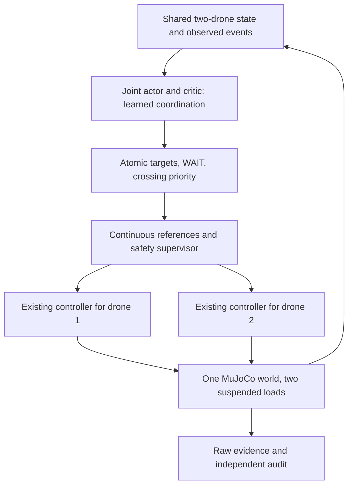

# Learned coordination of two drones with suspended payloads

- Date: 2026-10-27
- Status: Design accepted by the user on 2026-10-27; implementation in progress. No learning, benchmark, or acceptance result is claimed.
- PR: Not created; the user authorized local commits only. Include this spec with the implementation and tests in any future PR.
- Storage amendment (user approved, 2026-10-28 Asia/Singapore): work within existing disk capacity. Permanent internal-stage raw evidence is not required; retain trained models, test results, videos, and inputs needed to reproduce flights. This supersedes full-raw retention/recovery requirements below, without changing physical, safety, timing, learning, or statistical gates. See §11.3.
- Predecessor: [Elevated destinations and detail zoom](../2026-10-25-elevated-payload-destinations-detail-zoom/spec.md), reported merged by the user. Preserve that specification and all previous artifacts.
- Inspected local implementation baseline: `7ceeaeda6be009a65f19316b86db14c2603b2817`. Reconcile the actual merged base before implementation; this is not a claim that the local checkout is current main.

## 1. Intent and decisions

The primary result must be **a neural policy that learns cooperative decisions**: two drones, each carrying its own suspended payload, divide ten inspections, change responsibility during flight, and learn when to proceed or yield so that the whole team finishes sooner without collisions. Merely rendering a second drone, running two independent single-drone policies, or letting a handwritten dispatcher make every cooperative decision does not meet this goal.

The user requests learned cooperation, two suspended loads, shorter team patrol time, dynamic reassignment, collision avoidance, and use of a GPU server when it accelerates the work. The architecture, numerical budgets, margins, and statistical thresholds below are **author proposals**, not measurements or previously approved user thresholds. They form concrete defaults for implementation review. This document creation does not start remote jobs.

Approaches considered:

| Approach | Benefit | Limitation / decision |
| --- | --- | --- |
| Central joint actor and critic, two existing flight controllers, common safety supervisor | Learns assignments and yielding together; a small joint action space is inspectable; both drones share reliable simulator state | **Proposed first implementation.** Requires centralized observation and communication; do not call it decentralized MARL. |
| Two decentralized actors with centralized training, e.g. MAPPO | Natural path toward distributed operation | Adds partial observability, communication assumptions, and coordination credit assignment. Defer until the central learned baseline is established. |
| Learned joint motor control / continuous collision-avoiding trajectories | Could eventually learn flight and cooperation together | Confounds flight stability with coordination and discards the qualified controller baseline. Outside this PR. |

The demonstration is a **MuJoCo simulated flight**, not a real hardware flight. Neither global route optimality nor a general collision-avoidance theorem is claimed.

## 2. Current behavior and scope

The current system has one `MuJoCoFixture`, four motor channels, one current target, a single-drone Masked PPO router, and `C-local-lqr-v1` following a smooth reference. The formal flight configuration is native MuJoCo 3.15.0, float64, RK4, 16 internal substeps, and 100 Hz external control. The previous routing objective combines logical edge cost and weighted nominal arrival times; it is not physical team completion time. Its routing300 and physical127 results do not qualify two interacting assemblies.

In scope:

- Two complete physical assemblies in **one world and one clock**, independent starts, independent load samples, eight motor channels, and joint collision/contact auditing.
- A newly trained joint NN for destination assignment, mid-flight reassignment, voluntary waiting, and priority at a predicted crossing.
- Retained per-drone flight control, continuous reference transitions, a deterministic safety supervisor, finite three-seed learning, physical comparative evaluation, and three final videos.
- A measured choice of CPU/GPU execution, with GPU batching where useful; reproducible local artifact recovery and result/handoff documentation.

Out of scope: flight NN training, decentralized execution, communication loss, more than two drones, battery/charging models, package delivery or exchange, slack ropes, real flight, online weight updates during evaluation, learned aerodynamic interactions, and proving a global optimum for continuous dynamics. Each drone keeps its own payload throughout. A destination is an inspection completed by one drone, not a place where the payload is dropped.

## 3. Physical world and mission semantics

### 3.1 Assemblies and starts

Create a new `dual-payload-v1` profile. Namespace every body, joint, actuator, sensor, and geometry by drone ID. Resolve qpos/qvel/body/actuator addresses from model metadata; do not duplicate singleton indices. Both assemblies must advance in the same solver step. Independent single-drone simulations composited into one video are invalid.

Keep each drone's existing asset, mass/inertia, motor authority, attachment, 0.30 m link, rod geometry/mass, damping, and load distribution. Box side is independently sampled from 0.030/0.045/0.060 m; mass ratio is independently sampled in [0.10, 0.30] against the same fixed original reference mass. Keep the box/link model's limitations explicit.

Canonical starts are `drone-1=(-3.5,-3.5,1.0)` m and `drone-2=(3.5,3.5,1.0)` m, at rest with vertical loads. This is an explicit new initial-layout proposal. Canonical goals retain the predecessor A–J coordinates, including its elevated z values; do not silently move goals to remove crossings. Random cases use §8's generator. No return-to-start is required.

### 3.2 Ownership, service, and clocks

Goal state is `UNASSIGNED`, `ASSIGNED(drone_id)`, `SERVICING(drone_id)`, or `DONE(drone_id, completion_time)`. Assignments for both drones are committed atomically. A goal has at most one owner; a DONE goal cannot be reassigned or credited twice. An assignment change transfers responsibility only, never position, velocity, payload, or already elapsed mission time.

Use the predecessor `payload-settling-video-v1` for each inspection: drone/package position error ≤0.20 m, drone speed ≤0.30 m/s, package speed ≤0.15 m/s, swing angle ≤5°, swing rate ≤15°/s, and full box angular speed ≤30°/s, simultaneously for one continuous second. Service dwell is reset when interrupted; partial dwell cannot be transferred to the other drone. No extra nominal 0.5 s analytical service is added.

When service dwell starts, assignment is locked until completion or a safety interruption. Otherwise a new assignment has a minimum 1 s commitment, except on the declared exogenous event. Retargeting must start from the existing reference position/velocity/acceleration and actual physical state; no instantaneous waypoint or velocity jump is permitted. Reference speed/acceleration/jerk limits are frozen on development data and shared by every policy.

The primary metric `T_team` is actual simulated time from reset until all ten goals are DONE **and both assemblies satisfy the same settling predicate at their respective final hover references for one second**. This final dwell may overlap the last inspection dwell. Time spent waiting, yielding, recovering, or servicing counts. Raw last-goal completion time is also reported.

Explicit new team timeout contract:

- Keep the predecessor 30 simulated-second leg deadline, separately for each drone. It begins with the first assignment after its preceding completed inspection. Retargeting, WAIT, reassignment, and safety holds **do not reset or pause it**. Completion of an inspection by that drone ends its leg. A drone with no active leg may idle; the team clock still advances.
- Introduce a **300 simulated-second team deadline** to prevent indefinite idle/reallocation loops. This is a new dual-team bound, not a reinstatement of the obsolete single-drone 120 s cap.
- Keep 600 wall seconds per evaluation mission, measured from reset through final raw flush. Compilation/model loading is separately timed before reset. An infrastructure overrun is recorded, never converted to a physical success or silently granted a longer timeout.
- A mandatory external wait (§8) consumes both applicable clocks. A forced release does not cancel an already running leg clock. Deadline failure cannot be hidden by assignment churn.

### 3.3 Safety and contact geometry

Retain the predecessor all-flight floor clearance >0.10 m for oriented drone and package geometry, no forbidden contact, roll/pitch ≤60°, finite state, constraint residual ≤2e-5, and the applicable numerical audit. Retain strict-shadow settling as a separate diagnostic: its failure is neither a new formal gate nor a silently repaired historical result.

Add a proposed **0.20 m minimum surface-to-surface distance between the two full assemblies**, including rotors, body, suspension segment, and oriented box. Center distance alone is insufficient. Audit all cross-assembly geometry pairs, including rotor-to-other-link and box-to-box. Adjacent self-attachment exclusions must be enumerated and cannot exclude cross-drone pairs.

Audit existing non-colliding visual geoms. Add massless collision proxies when required for missing body/rotor/link coverage, preserving the original inertial model. Rotor disks are conservative swept-volume proxies, not a new motor/air model. Validate proxy contact activation with intentional collision fixtures; a trial must fail on either a forbidden contact or geometric margin breach, even if the contact solver subsequently separates the bodies.

MuJoCo contact simulation alone does not establish aerodynamic safety. Add a declared conservative rotor-wash exclusion: no part of the other assembly may enter a downward cylinder of radius 0.60 m and length 1.00 m below either rotor-plane center, using the plane's world vertical projection. These dimensions are an engineering proposal, **not a validated downwash model**. Report exclusion violations separately. Aerodynamic wake accuracy is outside scope; do not claim safe real-world close formation flight.

Reconstruct clearance from native/substep poses and geometry. Between retained states, use swept-volume checks or conservative displacement bounds with adaptive subdivision; never infer continuous safety from 100 Hz samples or video frames alone. Record minimum clearance, closest geometry pair, time, contacts, exclusion-zone incursions, maximum swing/spin, and both assemblies' floor minima.

## 4. Learned coordinator and deterministic execution

### 4.1 Observation and network

Use a central actor/critic with shared goal encoders and two drone tokens, initially hidden width 128 and two attention blocks, followed by joint-action logits and a scalar team value. This is a new architecture/schema trained from scratch. The existing single-drone checkpoint is retained as historical evidence; it is not loaded into incompatible joint-policy weights. Exact parameter count and implementation/library versions are recorded before learning.

At 5 Hz, observe both drones' positions, velocities, attitudes, angular velocities, payload poses/velocities, link angles/rates, current reference and target, commitment and leg ages, service dwell, last action, goal coordinates/priorities/status/owner, elapsed team time, current observed availability, and previous supervisor intervention. Include deterministic relative geometry and predicted conflict features under the current references. Do not expose future event identity/time, hidden simulator mass parameters, exact reference solutions, held-out labels, or a teacher's chosen action. Geometry uncertainty in safety envelopes uses the worst allowed box size; it does not reveal sampled physical size to the NN.

Normalize using fixed physical scales or training-only statistics; freeze normalization with weights. Swap drone identities and goal ordering during training with corresponding action/label permutation. Test equivariance of the data/action transformation; do not claim an equivariant network unless the implementation actually guarantees it.

### 4.2 Joint action

At each 0.20 s boundary, the NN chooses `(target_1, target_2, priority_drone)`. Each target is A–J or WAIT; priority is 1 or 2. A flat categorical space has **11 × 11 × 2 = 242** entries before masking.

- A target means assign/continue that goal; two identical non-WAIT targets are invalid.
- WAIT releases that drone's unfinished assignment and requests a controlled stop/hover. Another joint action component may take the released goal in the same atomic transaction. WAIT is distinct from a supervisor-imposed hold, which retains ownership.
- Completed targets, ownership/service-lock violations, minimum-commitment violations, and unavailable-drone actions are structurally masked. Mask redundant priority variants when only one is meaningful with a documented canonical encoding.
- Masking must not choose the fastest assignment or remove every predicted conflict in advance. The NN must have alternatives to learn cooperation. It may choose targets, WAIT, and priority; it does not output motor commands.
- New observed events become visible at the next 5 Hz boundary; event receipt time and action time are logged. Safety still runs at 100 Hz. Never invoke an extra uncounted policy decision between boundaries.

### 4.3 Supervisor and attribution

The supervisor predicts both reference motions over at least 2 s and checks their swept assembly envelopes, inflated by measured tracking/swing error and stopping distance. The usable horizon must cover the worst qualified braking time plus 0.20 s policy latency; increase the horizon rather than assume 2 s is sufficient. Track uncertainty growth and use the worst allowed load envelope.

On a conflict, the selected priority drone may proceed only if the other can execute a qualified braking/holding trajectory and a safe terminal hold remains reachable. Otherwise brake both. Re-evaluate at 100 Hz; a hovering drone remains an obstacle. Do not solve a conflict by teleporting, disabling contact, increasing motor authority, changing goal heights, or silently shrinking margins. If a safe braking action cannot be established, record a safety failure; a safety supervisor is not a blanket proof of feasibility.

For this first version, references connect current state to the selected goal with the existing smooth-reference mechanism; the supervisor supplies braking/waiting, not a hidden global route optimizer or an unbounded search for alternate waypoints. Deadlocks must be resolved by learned assignment/priority/WAIT choices; unresolved cases reach their fixed deadlines and fail. Additional detour primitives require an explicit action/schema revision before training.

Log proposed NN action, structural mask, committed ownership, requested reference, executed reference, priority, intervention reason and duration at every decision/control boundary. Report both the fraction of 5 Hz intervals with intervention and total supervisor-held drone-seconds. **Do not disable safety on physical acceptance runs to demonstrate learning.** Counterfactuals and ablations retain the same supervisor.

The supported claim is “learned task allocation and collision-aware yielding with deterministic safety supervision.” It is not “NN-only collision avoidance.”

## 5. Objective, reward, and finite training

Primary optimization is shorter physical team makespan, subject to safety and completion. Priorities remain meaningful as a secondary latency objective. Logical edge multipliers from the old router are not physical time; the old cost-shift task is retained historically and is not relabeled as makespan in this profile.

Use shared reward integrated over the actual interval `dt`:

`r = -dt - 0.02 * dt * sum(priority_j / 100 for unfinished j) - 0.10 * supervisor_held_drone_seconds - 0.05 * ownership_changes + 5 * newly_completed_goals`.

An ownership change excludes initial assignment and final completion; it includes releasing or transferring an existing goal. Count each affected goal once per atomic transaction. Reward uses only current observed priorities. Completion credit is issued once. On a failed/truncated episode add `-1000`; no positive terminal reward beyond goal credits. Record each component. Safety remains a hard evaluation gate, not a reward tradeoff. The selection metric is §9's physical time score, not reward.

Train joint PPO with seeds **42, 43, 44**; all receive the same architecture, data distribution, transition budget and optimizer settings, but independent initialization/RNG. Initial fixed settings: Adam learning rate 3e-4, PPO clip 0.2, gamma 0.999, GAE lambda 0.95, entropy coefficient 0.01, value coefficient 0.5, gradient norm cap 0.5, five epochs/update, minibatch 512, and **4096 aggregate joint transitions/update**. Batch size is total across worlds, never “per drone.” These are a starting proposal to be frozen after plumbing/qualification, before the three production seeds; no validation-driven hyperparameter search is authorized by this finite campaign.

Each seed has exactly **1,048,576 joint transitions** (256 updates):

| Stage | Transitions per seed | Cases | Backend |
| --- | ---: | --- | --- |
| 1 | 262,144 | Normal patrol, full two-load physics | Qualified fastest training backend |
| 2 | 720,896 | Equal normal / priority / availability-delay mixture | Same backend |
| 3 | 65,536 | Same event mixture | Native reference MuJoCo, to adapt/verify behavior under the formal engine |

Maximum production total is **3,145,728 joint transitions**, not twice this value for two drones. One transition advances one two-drone world for up to 0.20 simulated seconds; save actual elapsed duration on termination. The terminal PPO update treats a physical/deadline failure as terminal without value bootstrap. No surrogate-only curriculum replaces these physical stages. Stage 3 is required even if earlier stages use native MuJoCo. Transferring backend does not reset optimizer, normalization, counters or policy weights.

Only each seed's terminal checkpoint is selectable. Intermediate checkpoints support recovery, not extra model selection. Resume only with complete optimizer/RNG/environment/backend/counter state. Preserve incomplete seeds and failed runs; do not restart them as new favorable seeds, enlarge the budget, or substitute the heuristic and call learned cooperation complete. If this budget is insufficient, report the learning gate unmet and propose a separate campaign.

## 6. GPU strategy and qualification

**GPU use has a credible purpose here:** batching many independent two-drone physical worlds and NN updates. Two drones in one world alone do not supply that batch parallelism. A small MLP/PPO update or one interactive flight may be faster on CPU. These are hypotheses to measure, not promised speedups.

The official [MuJoCo Warp documentation](https://mujoco.readthedocs.io/en/stable/mjwarp/index.html) distinguishes throughput-oriented GPU simulation from native single-step latency and describes PyTorch integration. [MJX documentation](https://mujoco.readthedocs.io/en/stable/mjx.html) describes GPU batching and its single-scene tradeoffs. [SB3 PPO guidance](https://stable-baselines3.readthedocs.io/en/master/modules/ppo.html) recommends CPU particularly for non-CNN PPO. Consulted 2026-10-27; pin installed versions instead of treating evolving documentation as a compatibility receipt.

### 6.1 Prospective benchmark

Before production learning, obtain current server connection details/availability and inspect actual GPU, VRAM, CPU quota, RAM and disk. Do not assume the previous SSH host still exists. Preserve a machine/environment manifest without credentials. Benchmark:

1. Native MuJoCo CPU workers + CPU policy.
2. Same native workers + GPU batched inference/PPO updates.
3. GPU physics with MuJoCo Warp and device-resident controller/reference/reward/mask operations + GPU PPO. MJX is an alternative only if the Warp capability check fails; record why.

Use fixed development inputs, native worker counts 1/2/4/8 capped by actual CPU quota, GPU world batches 32/128/512/1024 capped by memory. Measure reset, controller/reference/supervisor, physics, mask/observation, host-device copies, inference, PPO updates, raw/checkpoint I/O, initialization/compilation and peak memory. No video rendering during learning. Use three timed repetitions of one 4096-transition rollout plus its five-epoch update after warm-up. This benchmark's disposable weights are never selection candidates. Account for all pilot transitions separately.

Project whole-campaign wall time including compilation, native stage 3, validation, final audit, rendering and recovery. Choose the qualified configuration with lowest median projected time; prefer native CPU if another configuration is within 10% of it. GPU selection requires both valid physics and >10% projected improvement over the best native-CPU configuration. Report learning-only speedup separately so long native audit work does not hide a useful learning gain. If no GPU route helps, explicitly report **“GPU acceleration was not beneficial for the measured configuration”**, with timings, rather than using GPU for appearance. Conversely, do not continue a materially slower CPU route merely to avoid GPU engineering.

### 6.2 Physics fidelity gates

GPU availability does not qualify a different solver. Inventory support for passive ball joints, contacts/proxies, per-stage motor force evaluation, resets, precision, RK4/substeps, state extraction, and per-world load variation. Python callbacks or loops per environment that serialize simulation must appear in timing; a CUDA model alone is not GPU physics.

Native MuJoCo remains the authoritative final evaluator. A GPU training engine must retain the same physical model, actuation, control rate, load range and safety semantics. Any precision/integrator difference is named as a training-backend approximation and recorded in a separate profile; no claim of bitwise equivalence. It may not silently replace the native acceptance engine or loosen thresholds.

Before using it for training, compare native and GPU on **36 paired development trials**: hover, vertical transfer, crossing and braking, each with nine ordered box-size pairs and alternating mass endpoints. Replay the same time-indexed motor inputs for short numerical comparisons, and also run closed-loop controllers for 30 s. Require no native or GPU safety/numerical failure; over the first 1 s open-loop, max position disagreement ≤0.01 m and attitude/link-angle disagreement ≤1°; over 30 s closed-loop, each engine must satisfy the task's settling/safety tests and corresponding completion times differ by ≤5%. Also perform passive energy/constraint and per-stage force qualification inherited from the predecessor on the modified model. A failing comparison blocks that GPU backend, not the native implementation. Preserve all discrepancies.

Requalify the two-assembly native scene before any production learning: isolated-actuator/address checks, reset isolation, passive and powered stability, intentional collision detection, joint stopping-distance qualification across load extremes, and 330 s nominal plus six paired endpoint stress tests (same-size boxes at min/max mass for all three sizes). Add the mixed-size/mixed-mass coverage above; old single-drone qualification alone is insufficient.

No old GPU-hour balance is inherited. Finite sample budgets still apply. Estimate time and storage before execution and report resource infeasibility rather than change physics, omit mandatory seeds, or consume validation as development data.

## 7. Baselines and attribution experiments

All methods run in the same two-drone world, with identical controller, reference limits, structural locks, supervisor, events, load samples and deadlines. All are causal and receive only observed events.

- **B-static:** partition eligible goals by the nearer initial start (ties by drone ID), keep that eligibility partition fixed, and greedily visit that drone's remaining goals using current distance. Only its currently commanded goal is ASSIGNED; the partition does not reserve every goal simultaneously. Use fixed drone-1 crossing priority when both choices are meaningful, otherwise the canonical legal priority. Empty partitions are allowed and reported. This tests the value of learned cooperation over simple splitting.
- **B-dynamic:** enumerate legal distinct target pairs, first maximizing the number of available drones commanded to a non-DONE goal, subject to commitment/service locks. WAIT is allowed only for an unavailable drone, an empty remaining eligible set, or the excess drone when fewer distinct assignable goals remain; `(WAIT,WAIT)` is not a candidate while a legal non-WAIT assignment exists. Safety holds remain available downstream. Among these work-conserving candidates, minimize the maximum assigned-drone ETA plus a 1 s charge per changed owner. An unassigned WAIT drone is excluded from the maximum, not given a fictitious zero completion; a forced all-WAIT state advances the clock. For each assigned drone, unimpeded ETA is the common smooth reference's nominal transfer duration plus remaining1 s service dwell. Choose priority by lower unimpeded ETA, ties by drone ID. If swept references conflict, conservatively add the priority drone's unimpeded ETA plus0.20 s to the yielding drone's ETA; if its path conflicts with an unavailable hovering drone, add the observed remaining unavailability duration. Sum applicable delays. Break objective ties by the sum of priority-weighted ETAs, then goal IDs/drone ID. No future event or fitted held-out data enters this calculation. Freeze the executable formula/configuration before production learning.
- **N-full:** the learned joint policy.
- **N-no-transfer:** the same frozen weights; once a goal is first assigned, mask transfers to the other drone until DONE. WAIT may pause but retains that fixed owner for this ablation. Apply the same rule to forced unavailability. This is an intervention on the frozen policy, not a separately trained baseline; report this limitation.
- **N-fixed-priority:** use the same frozen weights, but overwrite crossing priority to drone-1 **only when both priority choices are legal and meaningful under the current mask**; otherwise retain the canonical legal priority. Keep safety active and record every eligible opportunity and overwrite separately from safety interventions. At every step both ablations run a fresh policy forward pass on their own evolving observation and mask. They do not replay N-full's targets/WAIT or physical trajectory after the runs diverge.

Use B-static and B-dynamic as prospective validation baselines. After model selection, evaluate both ablations on the same validation cohort for diagnostics only; they do not permit model reselection. After joint freeze, all five methods use the same routing held-out cases (§8). Do not report only the successful intersection, cherry-pick videos, or claim optimality from beating a weak baseline. Existing single-drone F43 cost ratios are historical context, not comparable team makespan measurements.

## 8. Data, scenarios, and frozen campaigns

New namespace: `outputs/dual_payload_coordination_<UTC timestamp>/`. New schemas: `dual-case-v1`, `dual-policy-v1`, `dual-raw-v1`, `dual-freeze-v1`, `dual-media-v1`. New root seed **10272701**, keyed PCG64 streams `(root, split, case_index, field, attempt)`; split 10=train, 15=development, 20=validation, 30=routing-heldout, 40=physical-heldout. Separate field IDs for geometry, starts, each load, initial perturbations, priorities, event timing/target and training sampling. Persist IDs, generator source/hash and manifests before use.

Training has 10,000 keyed cases. Generate ten goals uniformly in x/y [-2.7,2.7] m and z [2,5] m, rejecting pairs closer than 0.50 m. Starts use opposite corners `(±3.5,±3.5,1.0)` plus independent x/y jitter in [-0.20,0.20] m, with both diagonal orientations equally likely and labels randomly swapped. Reject unsafe initial full-assembly configurations using the common envelopes. Limit geometry rejection to 10,000 attempts, then report generator failure without resampling case IDs. Goal priorities are independent integers 1–100. Loads use §3.1. Physical perturbations use independent keyed draws for each drone: roll/pitch uniform ±2°, swing angle uniform0–10°, swing direction uniform0–2π, additional x/y offset uniform±0.02 m relative to its own sampled start, zero initial velocities, and the predecessor attachment-consistent package construction. These offsets never reset either start to the old origin. Canonical basic/video cases instead use the vertical, unperturbed starts in §3.1; endpoint cases use10° swing with independently declared directions.

Three scenario classes, each 100 of the **300 validation** and **300 fresh routing held-out** cases:

1. **normal:** no exogenous event.
2. **priority:** at a keyed time uniform in [6,12] s, raise one fixed keyed goal ID to priority100. The target ID is drawn from A–J independently of every policy before execution. If already DONE or already priority100, record a no-op; never silently select a different target or replace the case. Event identity is revealed only at trigger time. This gives all methods the same exogenous event rather than policy-dependent event targets.
3. **availability-delay:** at a keyed time uniform in [6,12] s, a keyed drone becomes unavailable for new movement for 8 s, executing a qualified brake/hover. Its unfinished assignment becomes transferable and service dwell is interrupted. The other drone can assume it. Reveal duration at trigger time. This is an operational wait, **not a simulated motor failure or a direct state freeze**. Keep both flight controllers active. The delayed drone becomes available again after 8 s, without automatic reacquisition of its old target.

Class/latent event timing is not supplied before the event. Round a trigger upward to the next100 Hz boundary and use the same rounded time for all methods. At a boundary, integrate/audit the preceding step, credit dwell completion, apply exogenous events, then invoke the NN if this is a5 Hz decision boundary. Persist this tie order. No case rejection may depend on whether a policy completes, collides, reassigns, or looks interesting. The 300 routing cases now run full two-drone physics to measure actual coordination time; **unlike the predecessor's analytical routing300**, they are not cheap analytical episodes. Label this difference in every time/storage estimate.

Preserve fixed development challenges for head-on crossing, perpendicular crossing, altitude crossing, box/link clearance, mid-flight transfer, simultaneous completion, repeated WAIT, opposing priority commands, and delayed-drone takeover. These may be tuned on but never enter fresh held-out denominators. Before training, declare one transfer challenge with the delayed owner and its competitor equidistant enough to make takeover useful, and one crossing challenge where the shortest initial references conflict. Save full coordinates, events, expected eligible actions and hashes; do not regenerate them around the learned model.

Physical acceptance is a separate **127-case cohort**: 9 canonical basics (three scenarios × three common box sizes at mass ratio0.20), 18 paired endpoints (three scenarios × three sizes × min/max mass; both drones same endpoint), and 100 newly keyed mixed-load/pose cases from split40 (34 normal,33 priority,33 delay; ordered box pairs balanced as 11 each plus one predeclared extra pair). This keeps the familiar count while explicitly adding independent mixed loads to the random portion. It is not exhaustive coverage of every paired endpoint combination; the development/backend qualification covers additional mixed cases. Do not add routing300 to this denominator.

Generate/open split30 and split40 only after joint freeze; persist their generator declarations earlier. Freeze weights, normalization, baseline code, controller/reference/supervisor, physics/assets, margins/timeouts, scenarios/generator, schemas, camera, audit source, dependency versions and selection receipt. Any behavior-changing adjustment after exposure requires a new declared campaign and untouched held-out cohorts. Infrastructure retries retain original failures and exact case/model hashes; they are not tuning opportunities.

## 9. Selection and acceptance

All numeric success criteria in this section are proposed new gates. A physically safe demo without measurable learned cooperation is an incomplete result.

Define `score_i = T_team` for a successful case and **600 s** for any failed, incomplete or deadline-exceeded case; success requires `T_team ≤300 s`. Compute means over **every declared case**. Report actual successful makespan separately from this failure-penalized score, completion rate and failure reasons. This scoring does not excuse any safety violation.

On the common 300 validation cases, an eligible seed must have zero safety violations, ≥95% successful missions overall and ≥95% in each 100-case class, no invalid joint action/duplicate service, and supervisor intervention in ≤10% of 5 Hz decision intervals pooled over all its case time. Its mean score must be ≥5% lower than B-static and ≥3% lower than B-dynamic; each class's score may be at most5% worse than B-dynamic. To establish speed rather than only fewer failures, B-dynamic must itself complete≥95% of cases without safety violations, the NN/B-dynamic jointly successful subset must contain≥270 cases, and the NN's mean actual `T_team` on those same paired cases must be≥3% lower. Always disclose that subset's size alongside the all-case penalized score; do not replace the all-case metric with it. An inadequate comparator leaves the comparative claim unmet. Choose eligible seed by lowest overall mean score, then fewer intervened intervals, then seed number. If none qualifies, stop with learned-coordination acceptance unmet; no heuristic fallback counts as success.

Final acceptance requires all of the following after joint freeze:

| Gate | Required evidence |
| --- | --- |
| Learned routing quality | On fresh routing300: same safety/completion/intervention and mean improvement/class guard gates as validation. No reselection. |
| Statistical support | Paired bootstrap of 300 case-index differences `N-full score - B-dynamic score`, stratified by scenario, 10,000 resamples, fixed reporting seed10272799; upper endpoint of the two-sided95% percentile interval is <0. Report effect sizes and intervals, not only p-values. |
| Useful reassignment | On the 100 routing-heldout delay cases, N-full mean score ≥3% below N-no-transfer, and at least20 cases have a post-event ownership transfer followed by successful service of that goal by the new owner. Denominator remains100, including no-op/unhelpful events. |
| Learned yielding | On the predeclared crossing challenge N-full completes without supervisor intervention and with NN-controlled priority/yield visible in raw. Across routing300, N-full's total supervisor-held drone-seconds ≤80% of N-fixed-priority's, with no worse completion count. If the ablation total is zero, the reduction gate is unmet rather than dividing by zero. |
| Independent physical acceptance | Selected N-full: basic9/9, endpoints18/18, mixed held-out≥95/100, with **zero safety violations across all127**, independently audited. A settling/timeout failure may consume the5-case allowance; collision/clearance failure may not. |
| Numerical and semantic correctness | Qualified two-assembly native backend; independent full raw audit, complete action/ownership/event reconstruction, no counter resets, target teleports or hidden future information. |
| Media and delivery | §11's three exact final videos, machine checks, fresh full-length human review, local recovered artifacts verified by size and SHA-256, Japanese result/handoff and English PR description. |

Also report per-class median/p95 makespan, each drone's busy/wait time and completed count, priority-weighted completion latency, emergency-goal event-to-service delay, action churn, transfer counts, supervisor interventions, near-conflict counts, both payloads' motion, floor and inter-assembly clearances, strict-shadow results and failure traces. Separate throughput from real-time control latency. Be explicit if a confidence interval, effect size, frame coverage or physics gate misses its target.

## 10. Implementation work packages and compatibility

These are an implementation outline for the requested spec, not an assertion that product code exists. Keep old CLI/profile readers and checkpoints working and fail closed on mixed schemas/hashes. New public formats carry `drone_id`, `world_time`, per-goal owner/service state, proposal/execution and supervisor reason, two payload states, model/profile hashes and terminal reason.

| Step | Proposed files/modules | Exit evidence before dependent work |
| --- | --- | --- |
| 1. Contracts and cases | `dual_coordination_schema.py`, `dual_coordination_cases.py`, `configs/dual_coordination.yaml` | Work-start timestamp and timing/progress records (§11.1–11.2), versioned schema, keyed splits, explicit events/timeouts, predeclared challenge and baseline formulas |
| 2. Shared physical world | `dual_payload_mujoco.py`, narrowly reusable asset/solver helpers | Eight channels, no address aliasing, collision coverage, reset isolation, full two-body qualification |
| 3. Reference and safety | `dual_coordination_reference.py`, `dual_coordination_safety.py` | Braking/holding envelope, continuous retargets, margin proof/checks on development traces, deterministic intervention logs |
| 4. Environment and NN | `dual_coordination_env.py`, `dual_coordination_policy.py` | Atomic242-action semantics, masks, exact timers/reward, PPO update and deterministic save/resume parity |
| 5. Baselines and acceleration | `dual_coordination_baselines.py`, `dual_coordination_benchmark.py`, optional `dual_payload_warp.py` | Fixed baseline receipt, full timing, GPU fidelity receipt or documented rejection, storage/time estimate |
| 6. Finite learning and selection | `dual_coordination_train.py`, `dual_coordination_campaign.py` | Three terminal checkpoints, exact sample accounting, common native validation300 and prospective selection receipt |
| 7. Freeze and final evaluation | `dual_coordination_audit.py`, `dual_coordination_evaluate.py` | Immutable joint freeze; five-method routing300 and separate selected-policy physical127; raw independent reconstruction |
| 8. Media and recovery | `dual_coordination_media.py`, `dual_coordination_artifacts.py` | Three verified final videos, human hash-bound review, recovered inventory and reports |

Names are proposed integration boundaries; the builder may consolidate files without changing contracts. Reuse existing trace/audit/storage code through explicit dual-profile adapters; do not weaken old hash guards. New entry points should support `declare`, `qualify`, `benchmark`, `train`, `validate`, `freeze`, `evaluate-routing`, `evaluate-physical`, `render`, `verify`, and `recover`, with prerequisites enforced in code rather than prose only.

Required tests include: malformed/mixed schema rejection; identical-ID/contact/address bugs; both-drone reset isolation; exactly-once service and atomic target swap; service and commitment locks; WAIT versus safety hold; clocks through reassignment/delay; deterministic simultaneous events; reward accounting; no hidden event fields; structural mask legality; rotated-box/rotor/link clearance and crossing between samples; unavailable stop trajectory; deadlock termination; safe-state recovery without accepting a prior violation; split/field independence; held-out-before-freeze refusal; rollout counts and terminal bootstrap; checkpoint/resume equivalence; selection boundary/tie/no-eligible cases; missing/truncated/tampered raw; and video timestamps/visibility.

Use small CPU test fixtures for software contracts, then actual native physics for safety claims. Run the relevant full existing regression suite before delivery. A unit test, a safe geometric sketch, or a rendered animation cannot stand in for shared-world flight evidence.

## 11. Media, artifact recovery, and reporting

Produce three new continuous 1×, full-mission videos: canonical normal, a predeclared priority/transfer demonstration, and the predeclared crossing/yield demonstration. Select exact development case IDs before production training; do not select attractive held-out successes. A priority demo must actually show reassignment; if it does not, report that media/behavior target unmet rather than change the event or fabricate labels. Render from audited native raw for the frozen selected policy.

Use a fixed overview showing both complete assemblies and all ten destinations, plus two detail panels, one for each full assembly. A single tracking close-up cannot document the other drone's load. HUD in Japanese shows both IDs, current targets, goal ownership/DONE state, team elapsed time, priority event/delay, actual minimum assembly distance, NN WAIT/priority, and safety interventions. Distinguish learned proposals from executed commands. Avoid implying a theoretical optimum or real-world flight.

Freeze a new camera profile on development traces. Keep all body/rotor/link/box corners within each intended panel with a declared5% image border margin; verify every frame from projected geometry. Do not inherit the old0.90 m detail distance blindly or hide a failed view by removing part of the load. Verify monotone timestamps, duration against raw, no omitted time, and 1× playback; keep raw and rendered master. Record view/readability misses explicitly.

As soon as a new flight video exists, present its **local absolute path and measured metrics before the final narrative**: team time, each drone's goal count, transfers, min full-assembly distance, floor minima, safety interventions, settling result, and SHA-256. Final completion requires a new human review of all three exact final files, full length at1×, for both loads, altitude/crossing/yield visibility, frame coverage and Japanese text. Prior three-video approval is not reusable.

Before large runs, estimate storage from a representative full raw mission including both assemblies and internal-stage proof. Retain source/spec/config/assets, both baseline implementations, all three candidate checkpoints and recovery state, manifests, qualification and benchmark evidence, training curves/counts, complete selection/freeze data, all validation/held-out outcomes and required native raw, independent audits, all failures, video masters, renders and human-review receipt. GPU training may retain sampled numerical traces plus counters/checkpoints; formal native traces required for independent safety/numerical reconstruction cannot be replaced by training summaries.

Recover necessary evidence to local storage. Generate a relative-path/size/SHA-256 inventory at source and independently recompute at destination; require exact agreement and account for every missing file. Keep source copies until verification completes. Transfer no credentials or unrelated data. Use the new namespace and preserve all prior outputs and merged specs. Do not assume the old server is reachable or old credentials can be embedded in scripts.

Deliver `docs/dual-coordination-result-ja.md`, `docs/dual-coordination-handoff-ja.md`, and `docs/dual-coordination-pr-description.md` (English). Include measured GPU/CPU throughput and chosen backend, learning and ablation outcomes, confidence intervals, both held-out denominators, all unmet gates, physics/model limitations, local paths/hashes and exact reproduction commands. Link this spec from the PR description and maintain the index. No push, PR creation, merge or publication is implied by writing this spec; later repository actions follow the user's execution instruction.

### 11.1 Wall-clock time tracking and final retrospective

The user reports that the preceding session took more than24 hours and requires auditable timing for the next implementation session. Start recording at the **first work on that implementation campaign**, including reconnaissance/setup and planning, not only when training starts. Persist the campaign start before launching substantial work. Completion time is when all required work, artifact verification and human review have finished. If the work stops incomplete, report elapsed time through the handoff timestamp and leave completion unset. Preserve the original start across session resumptions; this spec-authoring session and historical campaigns are separate.

Record each major work item: planning/setup, implementation, test runs, physical qualification, CPU/GPU benchmarking, training, validation/model selection, routing held-out evaluation, physical acceptance, independent audit, video generation and checking, human-review waiting, data transfer, artifact verification, and final reporting. Split retries and failed runs into separate attempts; never replace their time with only the successful attempt.

Maintain an append-only `timing/events.jsonl` and a derived `timing/work-items.json` under the new run namespace. For every item/attempt retain:

- Stable work-item ID, attempt ID, parent/dependency IDs when applicable, category, short description, host/process or session identity, and status/result.
- Start and end timestamps in ISO8601 UTC, elapsed wall seconds, and measurement source with a retrievable log/receipt path. Open items have an unset end and an explicitly timestamped elapsed-so-far value.
- Monotonic start/end readings for a process lifetime where available, with process/boot identity; otherwise use timestamped logs and name that source. Do not subtract monotonic clocks from different hosts, processes with unrelated origins, or reboots. Record known wall-clock adjustments/synchronization uncertainty.
- Measured execution, waiting and blocked intervals, with reasons such as server queue, dependency, transfer availability, user review, or tool failure. Running training or a transfer remains execution even while the agent is waiting for its tool result. “Active execution” means measured work/process intervals, not CPU utilization or inferred human effort.
- Exit/failure reason, rerun/resume relationship, and evidence references. After a crash, preserve the last observation and label any unknown end/duration **`not recorded`**; a heartbeat is not proof of the exact crash time. Label a measured lower bound as a lower bound.

The final Japanese result and handoff must provide a per-item/per-attempt table of start, end, elapsed duration, measured execution/wait/blocked breakdown, outcome, and measurement source, plus overall elapsed wall time from campaign start to completion (or handoff if incomplete). Include failed attempts and reruns in the retrospective and identify the longest delays, repeated work and evidence-supported opportunities to shorten the next campaign.

For parallel work, report each item's duration and the separately measured overall elapsed span. **Never sum overlapping item durations and label that sum overall elapsed time.** Any aggregate active-time figure must be the union of measured execution intervals, with parent/child overlaps deduplicated. Label summed worker-hours separately if useful. A campaign-wide waiting/blocked total must exclude periods when other recorded work is executing; retain per-item waiting independently. Where clocks or missing observations prevent this reconstruction, report the affected breakdown as `not recorded` rather than inventing a partition. Overall elapsed time includes measured waiting, interruptions and human-review delays.

Every unmeasured duration must be marked **`not recorded`**. Estimates, if useful for planning or explanation, belong in separate fields labeled **estimate**, with their basis; they must not replace recorded durations or silently fill gaps. Do not retrospectively claim precision for the preceding24-hour session. These timing requirements add observability, not a new GPU-hour cap or permission to change mission deadlines.

### 11.2 Progress records readable from sidechat

Provide a durable progress source that a sidechat can inspect without interrupting the executing job. Under the same run namespace maintain `progress.json` and a concise Japanese `progress-ja.md`, updated atomically at phase/attempt transitions and at least every5 minutes while long jobs execute. Include campaign start, snapshot generation time, last worker heartbeat time, current item/attempt and state, elapsed time with its source, completed/total units where the denominator is known, recent failures/retries, waiting/blocking reason, next prerequisite or action, and absolute paths to timing records, logs and available artifacts. Show concurrent jobs separately. Never translate “job launched” into “job succeeded.”

Use real counters: PPO transitions/updates, completed validation or physical cases, rendered/verified frames, and transferred/verified files/bytes. Do not invent an overall percentage across unlike phases. An ETA is optional and must be labeled an estimate with measured throughput, remaining units, timestamp and exclusions; omit it when the basis is unavailable.

Keep a local progress copy for remote work and record the remote snapshot's source timestamp and latest successful sync time. A failed sync or missed heartbeat must be visible as stale/unconfirmed status, not proof that the job has stopped or that it is still progressing. A snapshot older than two expected update intervals is marked stale; retain its last known contents. Progress maintenance must not depend solely on the assistant producing chat messages while a long tool call is pending.

At campaign start, publish the absolute local paths to both progress files in the main chat and the Japanese handoff; maintain that locator across resumptions. Include a ready-to-use sidechat request, for example: 「このrunのprogress-ja.md／progress.jsonとtiming記録を読み、最終更新時刻、現在の作業、開始からの経過時間、完了数、待機・失敗理由、次の工程を教えて。古い情報や未計測値はその旨を示して。」 Replace “このrun” with the actual absolute run path in the delivered instructions. Sidechat answers must state their evidence timestamp and distinguish measured progress from estimates. This is a read-only inspection workflow; it does not require automatically messaging another chat or starting a recurring automation.

Retain timing/progress history and final snapshots in the recovered artifact inventory with size/SHA-256 verification. Freeze behavior/configuration independently of these evolving observability files; progress updates do not authorize changing the frozen experiment. Verify timestamp/duration provenance, separate failed attempts, overlap-aware totals, stale-snapshot handling and local progress readability before the long campaign.

### 11.3 User-approved bounded storage amendment

On 2026-10-28 (Asia/Singapore), after the measured full-stage storage estimate exceeded available capacity, the user instructed: 「ディスク容量を増やせないと仮定して、削れるものを考えて。証跡は残す必要はない。学習したモデル、テスト結果、動画など後で飛行を再現できる情報さえ残っていればいい」. This explicitly replaces permanent full-stage raw retention and transfer, including references to an independent *offline full raw* audit in §§9–11. No physical threshold, timeout, sample count, model-selection rule, or human video-review gate is relaxed.

- Audit native/internal stages while executing, including interval swept checks. Preserve the auditor version, coverage/counts, minima/maxima, violation details and terminal result per mission. Validate the streaming auditor against retained small detailed traces before production. Missing audit coverage remains a failure; a sampled 100 Hz summary is not a substitute for continuous checks.
- Keep compact exact native reset/checkpoint state, case/seed, proposed and executed actions, event/ownership/controller/reference inputs, frozen source/configuration/assets/dependency identities, model/normalization and optimizer/RNG/counters needed for recovery. Native deterministic replay must reproduce decisions, terminal outcome and measured metrics within declared tolerances; verify this on development missions before relying on compact retention. Preserve all failed outcomes and reasons, even when their full trace is discarded.
- Detailed internal-stage records may be streamed through bounded memory and discarded after audit. Retain only bounded qualification/debug samples. Render final video missions from verified deterministic replay with a temporary bounded render trace, or directly during replay; keep all three final video masters and their frame/timestamp checks and human-review receipts.
- Compact replay may explicitly retain the first and last100 Hz control tick of every5 Hz action, plus reset/checkpoints and any terminal tick. This bounded profile retains every proposed action and decision boundary; it is not a full-rate trajectory or an offline internal-stage audit. Record the profile/stride in the replay, result and recovery state, require matching profiles on resume, and continue online auditing every100 Hz control tick and all64 RK points/16 native intervals. Detailed debug traces use stride1.
- Validate deterministic native reexecution on development missions with the frozen executable profile before relying on retained inputs. A fresh second physical execution of every validation/held-out mission is not mandatory. A v2 reproduction receipt explicitly records `native_reexecution_performed=false`, verifies its retained reset/actions/boundaries/final-state stream, and binds the measured development replay qualification. It must not use v1's per-mission decision/terminal/metric replay-match booleans without actually reexecuting that mission. Full online internal audit, conservative failure handling, and every acceptance denominator remain mandatory. This execution/storage choice is declared before production learning and held-out exposure.
- Avoid duplicated archives, intermediate rendered frames, repeated copies of immutable assets, and obsolete recovery checkpoints after their replacement is verified. Preserve each of the three selectable terminal models and the current complete recoverable training state. Keep failed/incomplete run metadata and reproducible inputs. Historical merged artifacts are excluded from cleanup.
- Measure compact full-mission bytes, temporary peaks and remaining local/remote disk before large runs. Reserve headroom and fail explicitly on insufficient space. Recover this reduced required inventory with independent size/SHA-256 verification; retain source until verified.

This changes the availability of retrospective forensic raw inspection: it requires rerunning preserved inputs. Reports must disclose that limitation and distinguish replay verification from retained original full-stage evidence.

### 11.4 Development implementation rulings

- Before learning, stopping measurements reached3.35s including settling; sourcev2 incorrectly used only the current reference's brake duration to choose its horizon (sometimes2s). Enforce a prospective4.0s global minimum, still extending it for any longer current brake plus0.20s policy latency. Qualification must independently require that the worst measured stop over all seven endpoint/nominal cases plus0.20s fits this minimum. A current-state-only formula check cannot establish that requirement. Preservev2 results as development diagnostics, stop its pending benchmark/admission, and requalify the changed frozen executable before learning. No physical margin, kinematic limit, mission deadline or acceptance threshold changes.
- The inherited seven duration qualification probes each run330 simulated seconds. They are standalone solver/stopping qualification, separate from inspection missions and their300 simulated-second /600 wall-second limits. Preserve the predecessor's absent mission wall cap for these probes; record their wall time and an explicitly named no-progress infrastructure watchdog. This is not permission to extend an evaluation mission.
- Before learning, development pilot002 exposed an overly coarse Bernstein derivative certificate near the1.2 m/s limit. Ambiguous certificates may receive a larger finite subdivision budget (depth6 then10). Pilot003 also demonstrated that increasing a C2 stop duration can increase peak speed when initial acceleration is nonzero. The same stop family may try up to eight shorter durations when speed alone fails, within the existing64 total attempts. All accepted curves still require outward conservative speed/acceleration/jerk bounds≤1.2/.8/2. No new waypoint, physical-state snap, margin reduction, or flight-controller change is introduced. Preserve failed pilots and freeze these implementation details only after qualification.
- File-bound learning and joint-freeze receipts authenticate executable inputs, complete model/normalization/Adam/RNG/counter state, the actual training/validation manifests, and per-case compact result/audit/replay bindings. Numeric-only synthetic reports cannot authorize production or held-out access. General limitations of reconstructed continuous physics belong in explicitly named limitations; missing required audit coverage remains a blocking proof gap.
- The user explicitly excluded Genesis GPU regression on2026-10-28 because it is not a prerequisite for this MuJoCo campaign. Full local regression uses `pytest -q -m 'not gpu'`; actual two-drone native MuJoCo tests remain required.
- B-dynamic evaluates every structurally eligible pair using the declared ETA formula. If a hypothetical, not-yet-selected pair's C2 path cannot be certified, its conflict prediction is conservatively true; it does not abort the mission, remove the candidate, or replace the ETA formula. Record these uncertified-prediction counts/reasons. An infeasible action actually selected for execution still fails through the common environment. This resolves a predictor implementation ambiguity before production and does not weaken the comparator by turning unused candidate failures into mission failures.

## 12. Completion checklist

- [ ] Proposed design accepted for implementation; source base and server resources reconciled.
- [ ] New case/action/physical contracts and finite campaign declared before data exposure.
- [ ] Both-load shared-world physics and stopping/collision checks qualified.
- [ ] CPU/GPU measured and selected without changing physical acceptance semantics.
- [ ] All three finite NN training runs completed; validation rule applied exactly.
- [ ] Joint freeze recorded before routing and physical held-out access.
- [ ] Learned gains, transfer/yield attribution, and independent physical gates passed separately.
- [ ] Three new videos machine-verified and reviewed by the user in full at1×.
- [ ] Necessary artifacts recovered with independent size/SHA-256 verification.
- [ ] Work-item/attempt timing and sidechat-readable progress records retained; final overall/per-item time breakdown and retrospective include waits, failures, parallelism and unrecorded intervals explicitly.
- [ ] Japanese results/handoff and English PR description accurately distinguish passes and misses.

At authoring time every implementation/experiment checkbox remains open. Do not mark this research implementation complete solely because the spec is written or a safety-supervised pair can fly.
